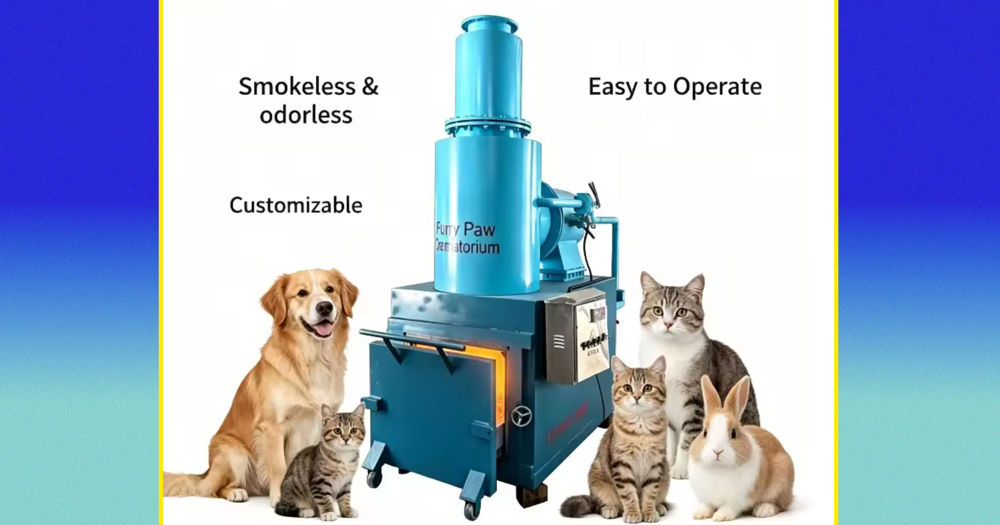

# Instagram为什么要给宠物焚化炉打广告

> 有Reddit用户发现Instagram在推送宠物焚化炉的广告，配图还是AI生成的健康可爱的猫狗，而这背后是中国电商平台在Meta系产品上投放的一连串此类广告。

Instagram上出现的宠物焚化炉广告使用了AI生成的宠物图

## 一条画风诡异的广告

如今你几乎能在网上买到任何东西，尤其是从中国直发的商品——那里是全球制造业跳动的心脏。无论商品多阴森，只要有价，就有公司愿意卖，甚至愿意在社交媒体上投广告给你看。

一名Reddit用户就亲身体会了这一点：他在Meta旗下的Instagram上看到一则“宠物焚化炉”广告。多名Instagram用户都标记了同一则广告，画面里是AI生成的、看起来健康、并不需要安乐死或火化的可爱猫狗，站在一台亮橙色、带可抽拉抽屉的燃烧设备旁，商品在速卖通（AliExpress）上销售。

一名困惑的Reddit用户回复说，他花了一会儿才意识到这是用来火化去世宠物的，一开始想到的是“不听话的狗被丢进宠物焚化炉”那种情形。

## Meta广告库里不止一条

检索Meta的广告数据库，能查到一条正在投放的“宠物动物火化机”广告，由速卖通的姊妹电商平台阿里巴巴在Facebook、Instagram和Threads上投放。另一条“无烟家用垃圾焚化炉 酒店小型宠物焚化炉”的广告，阿里巴巴在今年5月到8月期间也在同样平台上推广过。还有一条则是上月末投放的“全燃烧宠物医院用无烟猫狗焚化炉”。

目前尚不清楚这些广告是否与用户在Instagram上看到的那条直接对应。它们展示的并非完全相同的产品，不过其中一条也有两张狗站在焚化设备前的类似画面。而Meta的广告会因用户不同而呈现不同样子。广告界面上有一段Meta的免责声明：这则广告使用了动态产品，广告主提供图片、文案和平台偏好的组合，系统会自动为受众生成合适的组合。

## 速卖通上的同类商品

速卖通目前正出售一款设备，其照片与那条Instagram广告完全吻合，同样有卡通宠物，还配上堆砌关键词、为搜索引擎优化而写成的标题：“定制无烟死亡宠物尸体焚化炉 推拉门 家庭 家畜 家禽 农场 工厂 焚烧处理场所”。

宠物焚化炉虽然耸人听闻，但对于需要安全处置动物遗体的机构，比如兽医诊所，其实是种合理采购。可一旦投到社交媒体上，观感就变得微妙，尤其当它瞄准的不是兽医行业、还配上AI生成的可爱宠物图时。速卖通和阿里巴巴上的其他商品图片更令人生疑，比如有AI生成得像天使一样的小猫小狗，摆在同一类焚化炉里。

## 为什么此刻格外扎眼

电商平台兜售可疑商品的现象，今年早些时候被推到台前：检方指控新晋歌手大卫·“D4vd”·伯克（David “D4vd” Burke）从亚马逊和家得宝订购电锯、尸袋、铲子和一个“焚烧笼”等工具，称这是为了处置一名14岁女孩的遗体——他们指称他在一段不当关系后杀害了她。

Meta在控制其平台上畸形广告和恐怖AI内容的扩散方面一直存在问题。这家由马克·扎克伯格创立的公司未回应置评请求。有一点可以肯定：主流社交网络上这些AI粗制滥造的宠物焚化炉广告，阴暗得如此“当下”，以至于许多人忍不住用黑色幽默回应。一名用户在Reddit上开玩笑问，要是我用低温档，它能顺便烤牛腩吗？

