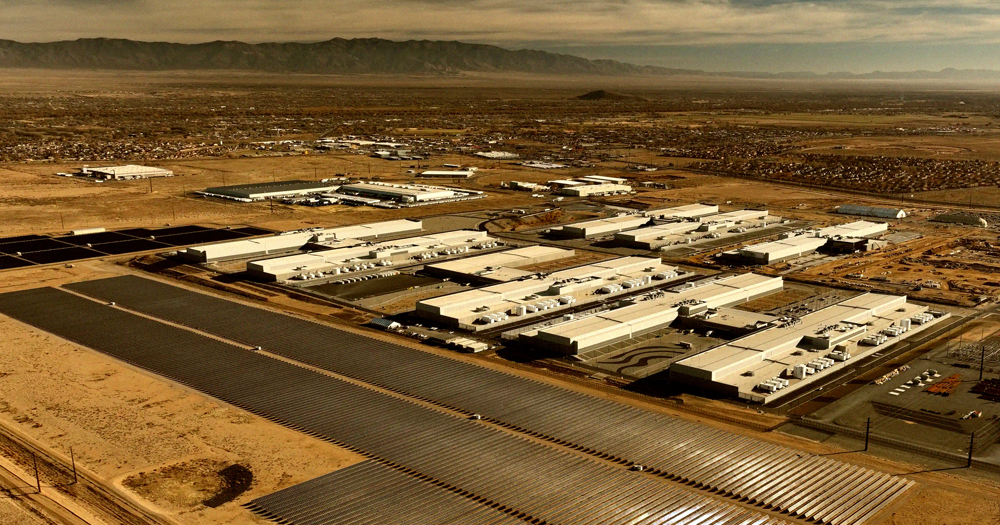

# Meta 被指用 AI 数据中心规避数十亿美元税款

> Meta 把动辄数十亿美元的数据中心建设列为里根时代的“试点模型”，两年间据此少缴约 60 亿美元联邦税，成为已知最大的税收抵免受益者。

Meta 数据中心可借“试点模型”名义申报研发税收抵免

## 把数据中心当成试点模型

按《纽约时报》报道，Meta 将耗资数十亿美元的数据中心建设项目归入里根时代的“试点模型”税收抵免条款，该条款原本是为试探性研发投入设计的。

换言之，这家由扎克伯格掌舵的公司一边告诉美国国税局这些数据中心能否回本“远无保证”，一边凭此申报数十亿美元抵免。

## 连自家会计师都称解释存疑

这一操作连 Meta 自己的会计师都承认，“试点模型”的解释“极其牵强”。据《纽约时报》查阅的最新证券文件，公司自己提示，因“研究税收抵免存在不确定性”，可能得把省下的钱退还给国税局。

先例并不少：据该报报道，国税局已点名数千家公司，指其把常规开支拿来滥用这项抵免。

## 两年省下近六十亿美元

Meta 利用这一漏洞已有两年。2024 年省下 20 亿美元，2025 财年申报又省了近 40 亿美元，成为迄今为止上市公司中已知的最大受益者。

国税局仍在追讨 Meta 2013 年借另一项漏洞为 News Feed 研发省下的 3.55 亿美元。

## 公众反弹与泡沫疑云

此事曝光正值公众对数据中心强烈反弹之际，这场跨党派运动声势渐大，可能在中期选举中产生影响；得知这些计划被用来逃税，恐将进一步激怒本就警惕的公众。

公司发言人 Andy Stone 向《纽约时报》坚称，Meta 为支持“美国就业”投入了大量研发资金，但国税局是否买账仍是未知数。这一做法也折射出更广泛的趋势：AI 行业以虚增的“氛围营收”和“创造性会计”著称，又在监管真空中运作，令外界对该行业泡沫破灭的担忧加深。

