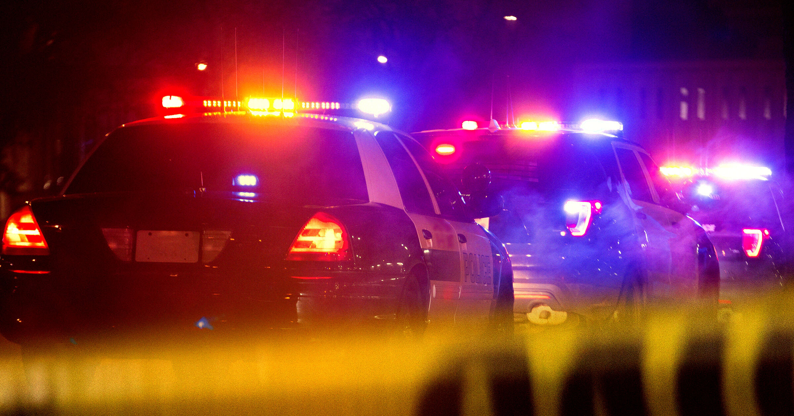

# 无辜夫妇凌晨被持枪警察包围，只因车牌识别系统认错了车

> 肯塔基州一对无辜夫妇凌晨4点被持枪警察和探照灯团团围住，起因只是Flock车牌识别系统在一桩路怒案里生成的一条几乎站不住脚的线索。

Flock车牌识别摄像头生成的线索引来大批持枪警察

## 凌晨四点的武装包围

肯塔基州列克星敦市的威尔·佩恩（Will Penn）和罗宾·佩恩（Robin Pen）上周末被卷进了一场暴力执法行动。据当地LEX18新闻台报道，上周六凌晨4点，警察包围了他们的住所，枪已出鞘，探照灯照进窗户。

如果这对夫妇以为敲门的警察会解释清楚，他们注定要失望。在提供给LEX18的家用监控视频里，一名警察说：“今晚发生了一起案件，我们要找的那辆车和你的几乎一模一样。”

## 一条纸一样薄的线索

列克星敦警方告诉这对夫妇他们并没有任何麻烦——尽管院子里大批武装警察的阵势完全不像这个意思。他们所做的，只是测试一条用自动车牌识别系统（ALPR）生成的、极其薄弱的线索。

据电视台报道，警方依据的是一桩重罪袭击案中受害者的描述。报案者并没有看清作案者的车牌，却对那辆车的品牌、型号和颜色相当有把握。

## 数据库一比对，目标就锁定了

把这几个特征输入由争议不断的车牌识别公司Flock Safety提供的网络后，列克星敦警方锁定了佩恩的皮卡作为可能的匹配对象，于是有了大批警力突击他家的理由——仅仅是为了碰运气抓到嫌疑人。

幸运的是佩恩有不在场证明。但他说，这件事留下的心理阴影挥之不去，尤其因为当时家里还有94岁高龄的祖母。“考虑到当时有武器、又是凌晨4点，这太可怕了，”他告诉LEX18，“我祖母被吓得不轻。”

## 警方的解释与家属的质疑

列克星敦警方指挥官丹尼尔·伯内特（Daniel Burnett）坚称，Flock车牌识别系统“只是执法部门可以获取的众多信息中的一种调查线索和资源”。

但佩恩一家表示，他们仍在等待一个解释：为什么如此薄弱的线索会招来如此极端的武力。“我觉得他们不再像以前那样认真做调查了，只是急着下结论，”佩恩说。

