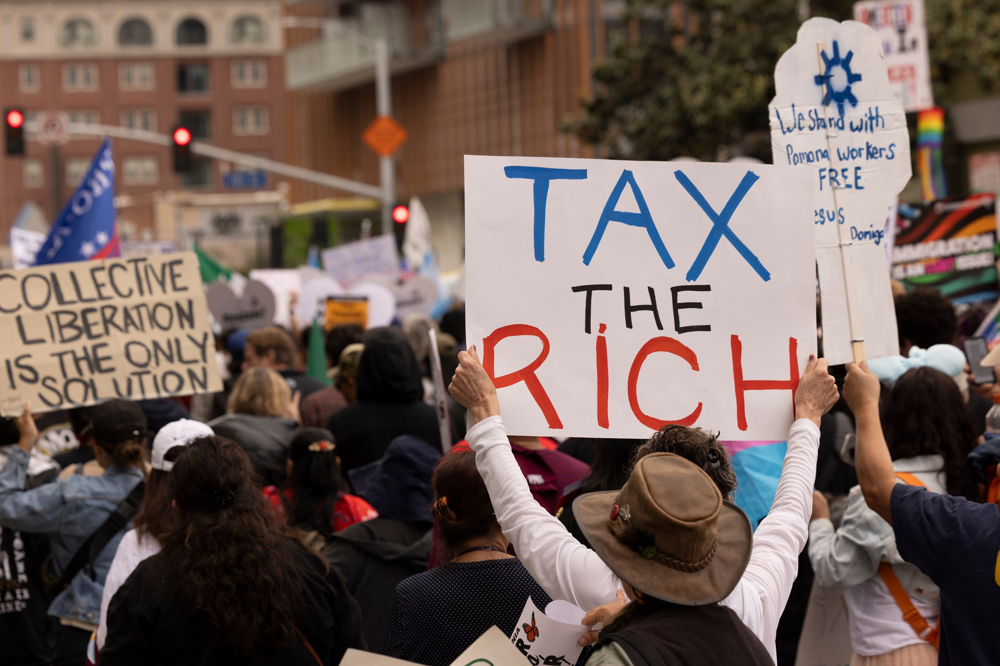

# 民调显示63%美国人支持暂停AI，多数人还要求对亿万富翁加税

> 《华尔街日报》最新民调显示，63%的美国成年人支持暂停AI，57%要求政府立即出手监管，而只有12%信任AI公司自我约束，同时多数选民要求给亿万富翁加税。

多数美国选民支持暂停AI，并要求对超级富豪加税

## 对AI的不信任创下新高

在11月中期选举临近之际，美国人对AI的反感——以及与之纠缠在一起的极度财富集中——仍在上升。

据《华尔街日报》的民调，高达63%的美国成年人如今支持暂停AI。整整57%的人认为美国政府应当“立即”监管AI，而只有低到谷底的12%表示信任AI公司能“带头”自我监管。

## 反AI情绪与反富豪情绪连着

谈论AI就无法绕开为这项技术输血的惊人财富：既有投入建设数据中心的资本，也有那些急着把AI推向市场的科技高管的个人身家。选民对此心知肚明，表现出压倒性地倾向于约束这个国家的亿万富翁——这些人合计拥有的财富超过57%的美国家庭。

《华尔街日报》调查的另一部分在9月底访问了共1500名登记选民，结果显示，那些把集体劳动阶层置于少数亿万富翁之上的政策主张，在民主党、共和党和独立选民中都获得巨大支持。

## 一串高支持率的政策主张

例如禁止意外医疗账单的法案获得90%受访者支持；对净资产超过10亿美元的美国人开征新的联邦财富税，获得61%参与者支持。强制医保公司覆盖医生开具的所有服务和药品的立法获88%支持，87%的人希望对处方药设定价格上限，另有79%赞成把信用卡利率上限定在10%。

## 民粹主义为何在两党都吃得开

这些立法提案单靠自身未必能扭转美国劳动阶层的处境。但考虑到绝大多数选民的压倒性支持，普通人的确承受着越来越难以与科技精英积累的巨额财富撇清关系的压力。

民主党民调专家约翰·安扎隆（John Anzalone）对《华尔街日报》说，人们习惯把世界分成保守派和自由派，也许该开始这样看：民粹主义在民主党和共和党的选民阵营里都是一种主导意识形态。当人们觉得自己买不起房、无法出头时，就会突然被过去从没想过的政策吸引。

