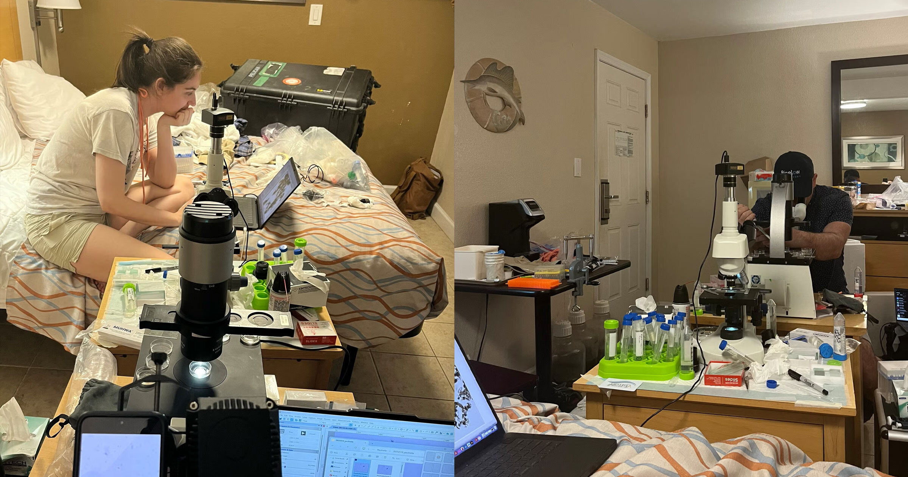

# 经费被特朗普冻结后，生物学家在汽车旅馆房间搭起实验室，意外发现新微生物

> 一群因特朗普冻结科研经费而被迫离开正规实验室的生物学家，把每晚80美元的汽车旅馆房间改成临时实验室，在那里发现了两种可能改写生命起源认知的微小生物。

生物学家在汽车旅馆房间里搭起临时实验室

## 特朗普冻结经费，把科学家逼出实验室

朱莉娅·范埃滕（Julia Van Etten）原本手握美国国家科学基金会6万美元的奖学金。2025年特朗普签发冻结联邦资金的备忘录后，她一度被挡在这笔经费门外。

等资金最终恢复时，混乱已经改变了这些科研人员的处境。科学家们开始互相打听、抱团，各自寻找官方实验室之外的研究方式。范埃滕的这支临时队伍，选择了一个意想不到的落脚点。

## 每晚80美元的房间成了实验室

他们把汽车旅馆房间布置成实验室，在里面研究收集到的Paulinella样本。范埃滕最初是在北卡罗来纳州度假时采集的水样里偶然发现了这种生物，《纽约时报》形容这几乎等同于“在千堆草垛里找一根针”。

正是在这间临时实验室里，他们注意到样本中其实混着两种不同的微生物。这一猜想随后由韩国的一间实验室通过DNA测序得到证实。

## 为什么Paulinella如此关键

Paulinella是一种难以捕捉的单细胞微生物。加上这次的新发现——相关论文发表在《Journal of Phycology》上——全球已知的Paulinella物种也只有六种。

科学家认为，Paulinella是观察复杂生命起源关键事件的窗口：一个单细胞生物吞下进行光合作用的细菌后，没有把它消化掉，而是改造成自己的能量工厂。这一融合后来演化成植物用来光合作用的叶绿体，正是它让生命从原始汤里自我复制的颗粒，跃升为大型复杂生物。

## 一次15亿年才可能重演的巧合

叶绿体的诞生发生在约15亿年前，长期被视为孤例。但Paulinella看起来在仅1亿年前也经历了一次自己的光合融合。

锡拉丘兹大学生物学家安吉拉·奥利韦里奥（Angela Oliverio）解释说，构成Paulinella的两个生物体之间的融合至今尚未完成，这让人类得以亲眼看到这一演化过程正在发生的瞬间。她告诉《纽约时报》，现在这是唯一另一个此类偶然演化事件发生的案例。

## 走投无路的科学家不止他们

科学家被迫用非常规手段为研究筹钱，并非孤例。另一支研究旱獭的团队在特朗普砍掉联邦研究经费后，专门开设了一个发布旱獭内容的OnlyFans账号，用这种方式维持研究。

