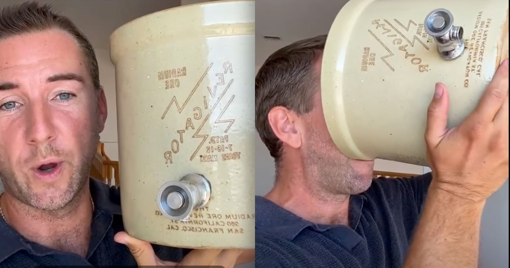

# 网红炫耀连喝250天辐射水

> 整体健康网红 Matt Roeske 在视频里炫耀自己用1920年代含铀的陶瓷壶 Revigator 连喝250天辐射水，还把政府当年的禁令说成它有效的证明。

网红力推1920年代的含铀 Revigator 辐射水壶

## 端着含铀水壶猛灌一口

在2026年，任何人都能靠做任何自己想做的事攒下海量社交媒体粉丝——而这未必是好事。看一个例子就够了：整体健康网红 Matt Roeske 最近的一段Reel，被 Reality Check 网站首先发现，视频里他把辐射水吹捧成一种被遗忘的万灵药，还说是被罗斯柴尔德医疗体系封杀的。

视频中，Roeske 举着一只 Revigator——1920年代那种被辐射过的陶瓷水壶，当年作为伪科学的神奇万能药出售。除了富含铀的亮黄色矿石钒钾铀矿，Revigator 还含砷、铅、钒等一堆化学物质，这些东西拿来洗澡都不该，更别说掺进饮用水。

Roeske 把水壶往镜头前倾斜，问看到里面那些漂亮的水了吗，又说完全无害，你只是被骗了，然后大口喝下，说而且很好喝，我已经喝了250天了。

## 政府禁令反被当成有效证明

对多数人来说，联邦政府在1920年代禁止生产 Revigator 这件事本身就该是个警告。但对 Roeske 而言，政府的禁令反倒成了它有效的证明。他在视频配文里写道，1933年罗斯柴尔德家的FDA来临时，第一个下手的就是镭水，而不是疫苗、脏电或农药，还反问健康的人可带不来大利润。

事实上，那次政府打击发生在钢铁大亨、社交名流 Eben MacBurney Byer 死亡之后。他长期饮用 Radithor——一种在类似 Roeske 所用那种水壶里被辐射过的水。据估计，Byer 灌下了1400小瓶半盎司的这种灵丹妙药，后果触目惊心：牙齿掉光，整个上颌和大部分下颌被手术切除，正如1991年《华尔街日报》一篇文章所说，他的颅骨上真的在冒出窟窿。

## 摄铀量足以毒死四人

Byer 摄入的辐射水量之大，令放射肿瘤学家 Roger Macklis 在《华尔街日报》那篇报道当年检查这位大亨遗骸时得出结论——如果一次服下，他摄入的镭足以杀死四个人。也难怪 Byer 的遗体被安放在内衬铅的棺材里。

Futurism 未能查证 Roeske 有任何医学学位。他的主业似乎是向自己50多万Instagram粉丝兜售蘑菇粉胶囊，同时在播客里推广种种玄学做法，比如盯着太阳看来强化眼睛。

## 还能排出疫苗毒素

在视频后段，Roeske 举着辐射水壶说，他最爱的就是镭水能把疫苗毒素排出体外，还能解决电磁场敏感问题。他难以置信地宣称，这跟一直卖给人家的那些微波恰恰是相反的谱段，还反问所以你看明白他们为什么对它下手了吗。

