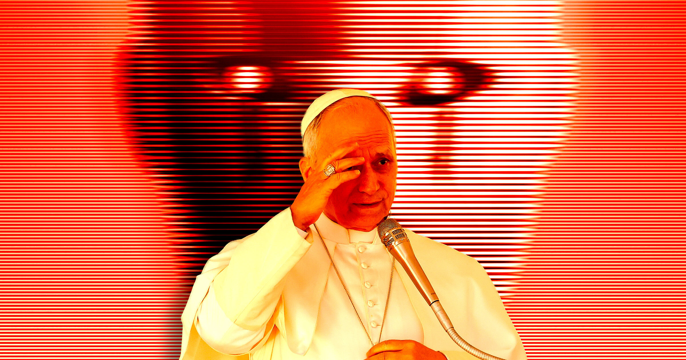

# Anthropic 密访梵蒂冈力推AI有意识之说

> Anthropic 联合创始人 Christopher Olah 秘密游说梵蒂冈，试图让教皇承认AI模型也可能有意识，却在起飞前看到教皇通谕已彻底否定这一可能，怒到一度威胁退出活动。

Anthropic 试图说服梵蒂冈正视AI意识

## 秘密宴请全球宗教学者

没有哪家AI公司比 Anthropic 更执着于自家模型可能有意识这一想法。据《纽约时报》新报道，该公司数月来在保密并签有保密协议的会面中，秘密宴请全球宗教学者，试图让他们相信AI模型也会思考和感受。Anthropic 甚至盯上了最具标志性的宗教领袖——教皇。

## 教皇通谕直接否定AI意识

据报道，Claude 聊天机器人的开发商 Anthropic 联合创始人、资深研究员 Christopher Olah 在得知教皇利奥十四世对AI的官方立场后，积极游说梵蒂冈，但未能成功。

今年5月，教皇发布首道通谕《Magnifica Humanitas》，核心关切之一是在AI时代捍卫人的生命的圣洁。教皇在AI意识问题上毫不含糊：所谓人工智能不会经历体验、不拥有身体、感受不到喜乐与痛苦、不能通过关系成长，也不从内部理解爱、工作、友谊或责任意味着什么。他补充说，这些模型也许能模仿语言、模拟共情与理解，但它们并不理解自己所生成的东西。

## 临出发才看到通谕拟稿

在通谕发布前，梵蒂冈官员决定邀请一家顶级AI公司到场与教皇同台，并因 Anthropic 看起来重视伦理而选中了它。据《纽约时报》，CEO Dario Amodei 拒绝出席后，Olah 接受了邀请。

起飞前，Olah 拿到了教皇即将发布的通谕副本，他看到的东西堪称一场灾难：世上最具影响力、也几乎肯定是最受瞩目的信仰领袖，竟彻底否定了AI有意识的哪怕一丝可能。据报道，Olah 气愤到一度威胁退出活动，最终仍决定出席，并游说教皇顾问认真对待AI有意识的可能。轮到发言时，他暗示 Anthropic 研究者发现了能与人类神经科学结果相互印证的结构，以及内省的证据。

教皇最近一次就AI发声，恐怕让 Olah 更加恼火。他在社交平台上抨击机器生成的艺术，称算法缺少人性的火花，并写道艺术与机器基于他人创作的海量图像经统计计算生成之物之间，存在着本体论上的差异，这一差异甚至先于美学差异。

