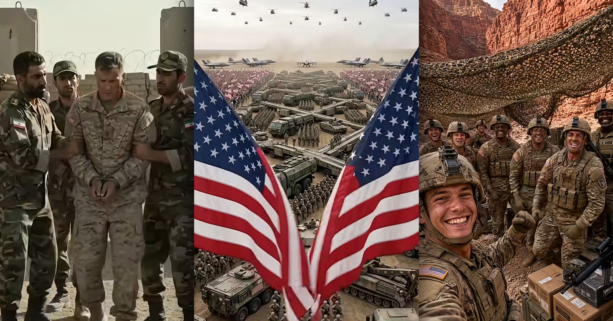

# Facebook放任账号用AI假战争影像盗取军功

> 内容农场在Facebook上用AI生成的伤残老兵、战俘和前线士兵影像骗取流量，到了盗取军功的荒诞终点——用彻底的合成物料去歌颂根本不存在的士兵，甚至伪造地点标记冒充战地新闻。

内容农场用AI假战争影像在Facebook收割流量

## 从粗糙老兵图到逼真战争片

真实的战争影像已经够骇人了。但当AI垃圾内容淹没每一条社交信息流，我们还得承受由生成式AI从肚子里吐出来的战争创伤与宣传，一切只为讨要点赞和关注。2024年生成式AI还在萌芽期时，我们就报道过社交媒体上讨好式的极端爱国垃圾内容。那些帖子很粗糙，一个臭名昭著的例子是轮椅上的伤残老兵，义肢硬塞进一只巨大的作战靴里。

随后又出现了恋足内容，既把军人性化，又歌颂特朗普。如今生成式AI成熟得多，能吐出逼真到难以想象的影像，规模惊人。对内容农场——那些为赚钱或搏关注而用低质帖子刷屏的个人和团体——AI的进步让它们能批量生产以TB计的战争标题党。这种战争垃圾几乎任何平台都有，但在Facebook尤为泛滥，点击农场用伤残老兵、战俘和现役作战部队的AI影像来拉动互动。换句话说，这是盗取军功的逻辑终点：宣传物料彻底合成化，歌颂的是根本不存在的士兵。

## 不存在的士兵在镜头前卖惨

账号 America's Honor 发布的一段Reel显示，一名美军士兵站在俯瞰无名山谷的前沿哨所上。这个账号2026年7月才开始发帖，却已有逾11.3万粉丝。

AI生成的士兵对镜头说，等等，别划走——这是这类垃圾内容的常见开场白——如果有一天我不再回家，请记得我也是别人的儿子，我妈妈失去的不只是一名士兵，而是她养大的那个男孩，如果你还支持我们的老兵，就点一下关注。该账号主页上有数百条这类帖子，播放量从几千到几十万不等。

虽然有些垃圾内容围绕笼统的军事演习或场景，但随手一搜就能翻出几十条描绘战争的Reel，全都为刷点击。在 America's Honor 的另一段视频里，一名美军士兵站在德黑兰与卡拉季的十字路口，远处燃起大火，大概是描绘美国入侵伊朗。视频对这名士兵入侵的国家几乎只字不提，不存在的陆战队员反而成为主角，配文写着每套军装背后都有一个等他回家的家庭，永远不要忘记他们的牺牲。

## 假地点标记冒充战地新闻

另一些AI生成的片段干脆省掉忧心忡忡的士兵，直接描绘美军的破坏场面。拥有10万粉丝的账号 Warfare NextGen 常发布美军飞机轰炸伊朗基础设施——主要是水坝——的帖子。每条Reel都标注了伪造的地点标记和时间戳，试图把片段包装成来自正规新闻机构的战争画面。

无论内容描绘什么，每篇帖子都涌满支持性评论，其中一些肯定是机器人，但大量来自真人。有人显然没意识到自己在看AI内容，也有人以一种令人不安的方式承认这是垃圾内容。在一条美军F-15轰炸阿巴斯港附近水坝、水坝垮塌后巨浪吞没村庄的帖子下，一位评论者先回复去谷歌一下就知道了，从没发生过，紧接着又说但这主意不坏。还有用户把垃圾内容的数量当成了轰炸确有其事的证据，回复说可能是真的，因为我在另一个角度看到过。

人很容易花上几天去梳理这类内容的数百个变体，以及它们煽动起的沙文主义情绪。但不管怎么看，生成式AI的兴起都催生了一种全新的战争宣传——不只是为军队拉支持、煽动对敌仇恨，更是把双方都当作巨大内容工厂里的道具。

