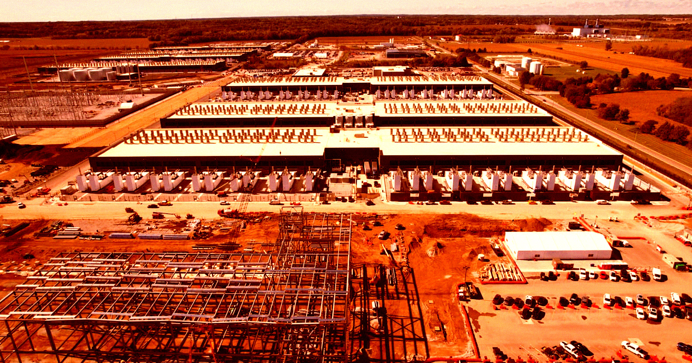

# 亚马逊警告地方社区不要抵制其AI数据中心

> 亚马逊云服务CEO Matt Garman发表3000字博文,呼吁社区接纳数据中心并指责媒体散布“虚假信息”,但泄露文件和Axios报道显示亚马逊曾隐瞒数据中心用水与排放的真实情况。

亚马逊云服务CEO以“国家高速公路系统”作比,力劝社区接纳其庞大的AI数据中心。

## 三千字博文恳求接纳

在AI议题上,科技行业大体上没能赢得公众支持。数据中心已成敏感话题,绝大多数美国人——一个仍在壮大的两党群体——如今公开反对它们。与此同时,惊慌的高管们拼命调整说辞以争取支持,这些最后一搏收效甚微。

为此,亚马逊云服务CEO Matt Garman发表了一篇3000字博文,恳请社区接纳数据中心,称美国“输不起”这场AI竞赛,并以二战后美国兴建高速公路作为类比。“就像国家高速公路系统一样,我国的经济、国家安全与日常生活都将受益匪浅。”他写道。

## 归咎媒体与对手

这位高管指责媒体散布“虚假信息和彻头彻尾的谎言”,称“在社交媒体和24小时新闻的时代,谣言比以前传播得更快”。Garman甚至声称美国对手“正有意在美国散布关于数据中心的虚假信息,诱使我们放慢脚步”。

“目前全美有100多项数据中心禁令正在审议中,”Garman写道,“如果这些措施付诸实施,美国可能亲手为自己写下一张输掉这场竞赛的罚单,后果将延续几代人。”在博文中,他试图淡化数据中心推高电价、产生大量污染的担忧——尽管大量证据恰恰相反。

## 被掩盖的用水与排放

考虑到巨大的反弹,他试图破除“谣言”并不意外。但由于他在淡化这些担忧上有着无法忽视的既得利益,我们对Garman的说法应大打折扣。就在去年,泄露的亚马逊内部文件显示,高管们正就如何让公众对数据中心耗水的“真实规模”一无所知交换意见。

今年早些时候,Axios也报道称,亚马逊的AI扩张导致公司排放量空前飙升,尽管它曾承诺到2040年实现净零碳足迹。Garman声称数据中心并未用备用柴油发电机排放大量碳,但证据恰恰相反——仅在得州,数十座AI数据中心设施就利用监管漏洞使用对环境有害的发电机。他还不忘强调数据中心“创造了数千个建筑岗位”,却只字不提这些岗位在建成后大多便消失了。

本周《华尔街日报》民调显示,62%的美国人支持暂停AI数据中心建设,其中40%将其列为头等要务。Garman这篇以宣布成立名为“Built Together”的“新社区计划”收尾的急切恳求,恰恰说明这个行业已经多么离谱地偏离了正轨。

