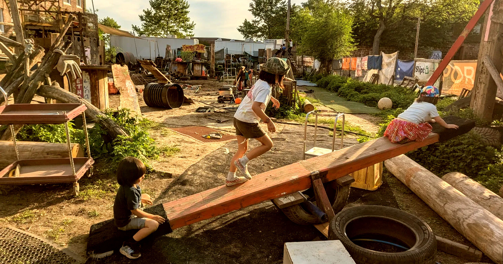

# 纽约家长把孩子送进能玩锯子锤子的废品游乐场

> 为让孩子远离屏幕，纽约家长把孩子送到叫 The Yard 的废品场游乐场，任由他们拿着真锯子、锤子和刀子玩耍，成年人只在远处看着、尽量不插手。

纽约的废品场游乐场让孩子用真工具玩耍

## 拿真锯子锤子对抗屏幕成瘾

如今的孩子是不是太娇气了，被iPad和AI聊天机器人伺候惯了？据《华尔街日报》报道，在纽约市，一些家长把孩子送往终极的无屏幕体验：一个名叫 The Yard 的废品场游乐场。在那里，孩子们被松开束缚，自由地做正经的青春期活动——在泥里打滚、擦破膝盖，当然也包括摆弄各种废旧零件。

他们不是在屏幕里捶打虚拟树木，也不是瘫着刷竖屏视频，而是玩真正的锯子、锤子和刀子，仿佛上帝——或者那些童年观感由反复观看《伴我同行》《沙地传奇》《七宝奇谋》塑造的成年人——所期望的那样。

## 远处看护的成人尽量不插手

成年游戏指导员在远处看着孩子，其余时间尽量不插手，这就是非结构化玩耍时间。其理念是让孩子想干什么就干什么，从而培养出能支撑一生的独立性。家长把孩子带来，是为了让他们免于屏幕时间的危害；报道提到，另一家微学校则向担心AI的家长提供一个让孩子躲开感官轰炸的地方。

报道描述了一幕典型场景：有的孩子在滑索，一个攥着一把钉子爬梯子，另一个推着手推车问谁需要铲子、锯子或锤子。家庭在孩子入场前要签免责声明，The Yard 也投了责任险。联合创始人兼首席游戏指导员 Yoni Kallai 每天开场时先问孩子们的名字，以及他们期待做什么。一个男孩说我喜欢搞破坏，旁边的朋友也说我也喜欢搞破坏。

## 几十年前这本是孩子的常态

几十年前，这种随性——说实话还有点危险——的户外玩耍对孩子来说是常态。在电子游戏替你打发时间之前，你得自己想办法找乐子。如今这已罕见，或许孩子们正因为不再能在虚拟环境之外与伙伴用愚蠢的方式消磨时光，而失去了一点什么——那个虚拟环境本就被设计来滴灌令人上瘾的多巴胺。

