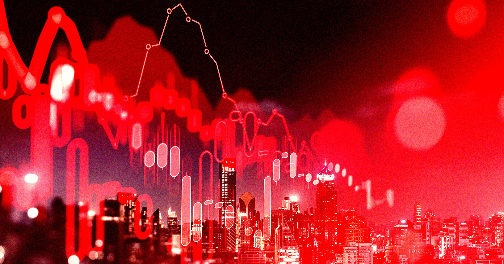

# 评级机构放话整个经济即将被AI抹平

> 信用评级机构 Egan-Jones 以《结束了》为题发文断言，AI已发展到让经济全面受冲击几乎不可避免，按小时出售专业知识的公司首当其冲，连货币本身都将悄然贬值。

评级机构 Egan-Jones 断言AI将颠覆整个经济

## 一篇题为结束了 的评论

信用评级机构 Egan-Jones 听完了所有关于AI杀人狂式末日的严肃讨论，然后抛出一个平淡却属于金融范畴的末日。在一篇直白命名为《结束了》的评论中，该机构宣称AI即将抹平那个被称作经济的集体迷信与资本主义长期骗局。

其摘要写道，AI已进步到让经济的彻底受扰几乎不可避免，而出售专业知识、包括资深人才、按小时计费的公司首当其冲，预计专业服务业利润受挤压、风险资本回报下降，屏幕化岗位受冲击还会给房价带来短期压力。

## 新一轮AI焦虑的背景

AI所谓的存在性风险眼下是热门话题：Elon Musk、Dario Amodei、Mark Zuckerberg 等行业领袖最近前往白宫，签署了一份实质上是拉勾保证的文件，承诺自我监管、不造会毁灭世界的模型。回到现实地面，专家们仍担心AI自动化可能颠覆整个行业、消灭整类岗位。

这些担忧并不新鲜，Egan-Jones 之所以现在发出不祥判断，是因为最新模型的能力似乎在输出质量与速度上越过了可被广泛采用的门槛。该机构预测，企业不仅会用AI节省运营成本，AI还会创造一种全新范式：人很少的公司远比以前成功，有些甚至一个人都没有。

## 资本与咨询业一起贬值

由于拥抱AI的初创公司能用更少投资成长，Egan-Jones 断言资本对那些曾依赖它的公司开始变得没那么重要，结果是货币价值悄然通缩：风投机构失去杠杆，回报被压缩。它还将重创咨询公司和其他专业服务——建议如今可以来自AI聊天机器人，而不只是穿西装的人，一些咨询公司已因与AI相关的裁员而瘦身。

## 别忘它只是家小机构

值得注意的是，Egan-Jones 是家小型信用评级机构，其预测分量不及三大评级巨头。许多经济学家说，眼下我们对AI造成失业的图景并不清晰，可能被夸大，因为雇主乐得把纯粹出于财务原因的裁员归咎于AI。无论如何，经济灭绝被认真当作我们的未来在兜售，本身就说明了当下的处境。

