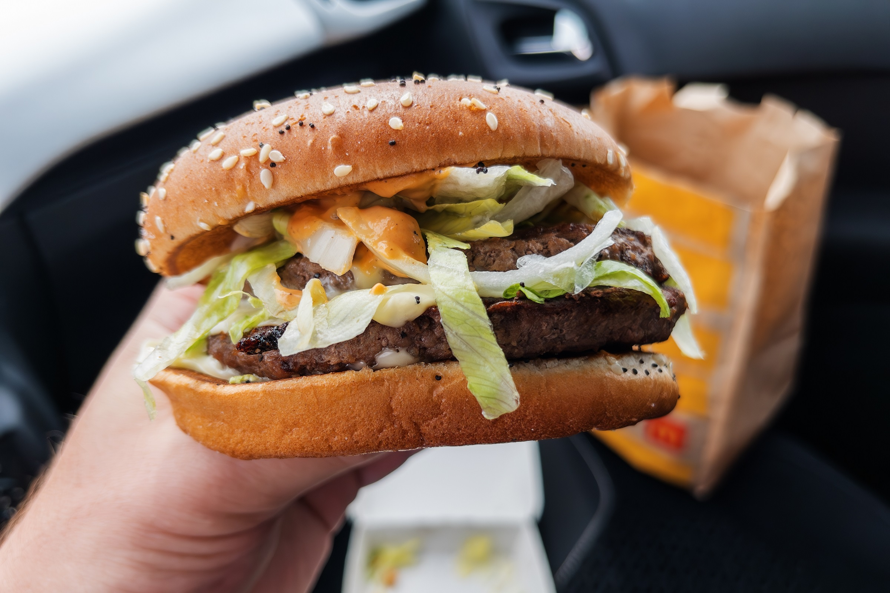

# 麦当劳暗中用AI模型为汉堡定价

> 同一城市相隔两英里的两家麦当劳，巨无霸差价高达21%——据路透社调查，这家快餐巨头已在全美近1.4万家门店秘密部署AI定价模型，估算顾客愿意为每样商品掏多少钱。

麦当劳用AI模型为全美近1.4万家门店的菜单定价

## AI给每个汉堡算出最优价

下次你在麦当劳为一个味道平平的汉堡掏钱时，背后可能不只是那些面目模糊的高管在定价。据路透社调查，这家快餐巨头正在全美用AI模型决定菜单价格，系统会估算每家门店的顾客愿意为某个商品付多少钱。

报道称，麦当劳的机器学习算法持续分析每天数百万笔交易，为全美近1.4万家门店的每一样菜单商品计算出一个最优价格。三位加盟商告诉路透社，这套AI定价引擎拉大了门店之间本已存在的价差，有时近到只隔几个街区。

## 相隔两英里差价两成

路透社的实测发现，加州弗雷斯诺的一家门店巨无霸卖5.69美元，而仅隔两英里外的另一家卖6.89美元，高出21%。

麦当劳对路透社坚称，这个AI定价门户是工具而非强制命令，但多名加盟商表示自己是被迫使用了这套方案。AI驱动的动态定价在餐饮业越来越常见，只是出于声誉风险，企业很少主动承认。

## 名义是工具，实则套牢加盟商

在麦当劳，AI给出的建议并非总让加盟商满意。顾客担心价格被AI推高，门店老板却担心价格被压低——因为麦当劳总部按门店营收而非利润抽成，哪怕门店亏钱，总部仍能抬高自己的账面收益。报道称，这已在加盟商与总部之间引发摩擦，因为AI近来常常建议降价。

更微妙的是，总部每年至少三次向加盟商下发AI定价指引，并追踪他们的定价不合规情况。CEO Chris Kempczinski 据称告诉投资者，定价合规性已成为评估加盟商的考量之一。部分AI建议本身由总部设定的目标引导——麦当劳与AI公司 Tiger Analytics 合作，经常给出诸如重点上调至少两年未涨价商品价格这样的指标。

这也不是麦当劳第一次用算法自动化运营：它还在第二次尝试AI得来速，并使用AI招聘系统。

