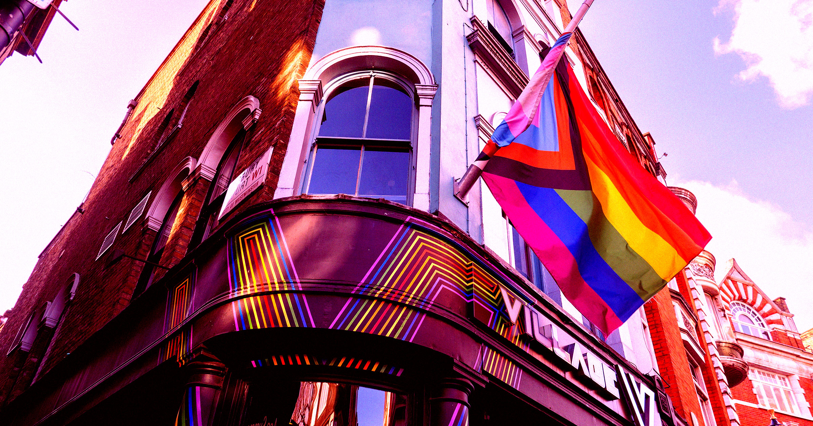

# Meta封杀同性恋酒吧账号却放任露骨虐童视频

> Meta以“不当内容”为由封禁得州奥斯汀两家同性恋酒吧的Instagram与Facebook账号,与此同时平台上仍充斥着包括虐待儿童在内的AI垃圾内容。

Meta一边下架同性恋酒吧的变装表演照片,一边对平台上的有害内容视而不见。

## 酒吧账号被封

Meta的平台早已沦为AI垃圾内容的肮脏泥潭,从暴力虐童到极端爱国主义的引流帖,莫不如此。但更耐人寻味的是它究竟把力气花在哪里:在审查了得州奥斯汀两家同性恋酒吧的账号后,这家公司显然把矛头对准了LGBTQ群体。

酒吧Oilcan Harry's和Rain on 4th的Instagram与Facebook账号均被标记并封禁。据Chron报道,变装表演者的照片被判定为“不当”,公司还威胁称类似帖子会降低酒吧的“可见度”。Rain on 4th总裁Scott Neal表示,Meta未就其Instagram账号8月初被下架给出任何解释。

## 用AI取代人工审核的代价

“你会感到无助,像是被困在一个不公平的体系里,却不知道如何脱身。”Neal说。这一事件凸显出Meta庞大平台上内容审核的严重失败。

这家由扎克伯格掌舵的公司去年宣布用AI取代人工审核员,而充斥垃圾与仇恨言论的平台状况表明,此举显然没有奏效。事件也折射出硅谷整体右转——科技高管对一个明确针对LGBTQ群体、废除相关法律并侵蚀其权利的政府俯首帖耳。

## 更广泛的沉默

GLAAD在去年的年度报告中指出,Meta自2024年以来经历了“尤为极端”的意识形态转向,不成比例地压制LGBTQ用户和内容。2025年1月,特朗普第二次就任总统后不久,Meta正式取消了保护LGBTQ群体的仇恨言论规则,使他们更加暴露。

这种转向正在产生实实在在的后果。Rain on 4th新建替代账号后,原账号却突然被恢复,反倒是新页面被封。这类毫无逻辑的混乱可能重创小本生意。据《洛杉矶时报》上月报道,洛杉矶多家知名酷儿夜店的社媒账号被下架,管理层数月困惑而Meta毫无实质回应。Meta依靠AI治理平台的努力显然没有回报,其内容政策的摇摆正把LGBTQ群体推向风险之中,也令自身受损的声誉雪上加霜。

