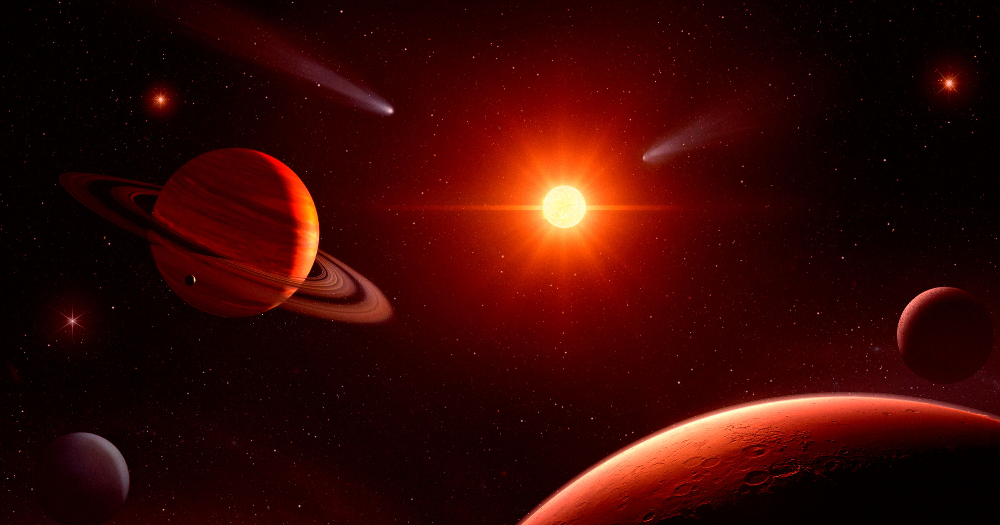

# 太阳系并不稳定终将走向毁灭

> 新研究用超级计算机推演发现,太阳坍缩成白矮星后行星轨道可能相互交错,整个行星系统或最早在十亿年内便陷入混乱与毁灭,远比此前设想的更早。

新的模拟显示,垂死的太阳会以不可预测的方式抖动,并抖落自己创造的行星系统。

## 常规认知与新结论

科学家认为,位于太阳系中心那团由氢和氦组成的巨大球体诞生于约45亿年前,让地球上的生命在数十亿年后得以繁衍。常规模型认为,太阳会在约60亿年后膨胀为红巨星,再坍缩成白矮星,走向终结,但其幸存行星的命运一直存在争论。

此前研究认为,靠近太阳的行星(包括地球)会被吞噬,而更远的气态巨行星在太阳消亡后很长时间里大体完好。然而发表在《天体物理学杂志快报》上的一篇新论文描绘了更黯淡的图景。

## 动力学不稳定性

由加州理工学院天体物理学家Konstantin Batygin领衔的团队认为,这些遥远天体恐怕也撑不过太阳坍缩为白矮星后的十亿年。白矮星是恒星核心留下的极致密残骸。

他们提出,甚至在太阳变成白矮星之前,各行星轨道就有很高概率彼此交错——这种“动力学不稳定性”可能比此前设想的更早让整个行星系统走向终结。真正的混乱最早可能在太阳化为白矮星后仅十亿年便启动。

## 太阳的临终踢击

为得出结论,科学家用超级计算机模拟了太阳在数十亿年间走过生命最后阶段时各行星的运动。他们认为,太阳向白矮星的转变可能伴随“随机踢击”,即猛烈抛射物质。

换言之,这颗恒星的临终挣扎可能突然且难以预测,打乱它数十亿年前所造行星的轨道,最终将其“暴力驱散”。论文写道:“我们的结果把太阳系的解体拉回天体物理熟悉的范畴,并改写了它的缘由:不是混沌的缓慢渗透,也不是与路过恒星的偶遇,而是太阳本身——它在死亡时不只扩张了自己建造的行星系统,还晃动它,且往往把它抖落。”

