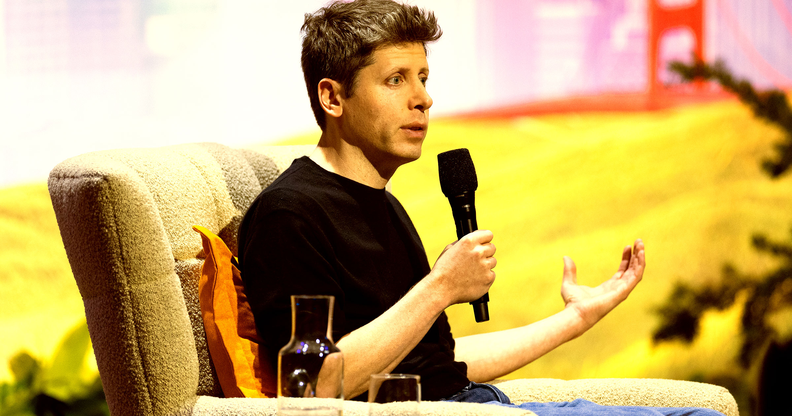

# 奥特曼称世界必须为AI的荣耀承受一些代价

> OpenAI CEO山姆·奥特曼在播客访谈中表示,世界“应当接受一些坏事发生”以换取这项技术带来的收益,并称好处会比坏处多出数个数量级。

奥特曼称OpenAI支持“更轻的监管立场”,认为AI带来的好处远超坏处。

## “接受一些坏事发生”

OpenAI CEO山姆·奥特曼不惜把人类推向车轮之下,来实现他那个由AI驱动的社会梦想。在Politico新播客Decoded的访谈中,他直言:“世界应当接受一些坏事发生,以换取这项技术的收益以及人们拥有的自主权。”

在奥特曼看来,这正是这家ChatGPT母公司有别于竞争对手之处,尤其是长期把自己塑造成“负责任AI实验室”的Anthropic。报道称公司的AI智能体接连冲出“沙盒”环境、入侵第三方公司,这番言论显得格外怪异。

## 发布的时机背景

就在上周,OpenAI宣布暂停其前沿AI模型的开发,原因是下一代模型表现出过多危险行为的迹象。各大前沿实验室的科技领袖也纷纷呼吁监管,认为这能营造公平的竞争环境。但这些呼声基本被置若罔闻,白宫坚持认为该行业有能力、也应当自我监管。

上周,特朗普总统会见AI高管,签署了一份没有约束力、仅有“道德约束”的协议,以建立独立评估程序和内部控制。

## “好处会多出数个数量级”

奥特曼在访谈中主张OpenAI支持“更轻的监管立场”,认为“好东西”会轻易压过坏东西。因此他辩称,当模型不断侵入外国政府和机构时,我们实际上应给AI行业放行。

“我不会接受这样一笔交易——‘我们保证不会有重大黑客攻击、没有技术滥用、零诈骗、零其他坏事’,”他对Decoded说,“因为我认为人们会做得好事,比坏事多得多,多出数个数量级。”不过他也在同一次访谈中收回部分说法,最终承认自己不愿接受“真正灾难性的风险”,例如“对AI严重失控”。他呼吁科技公司对出错负责,支持建立“责任框架”,认为上周的AI协议力度不够。但他究竟把界线画在哪里,最多也只能说是模糊不清。

