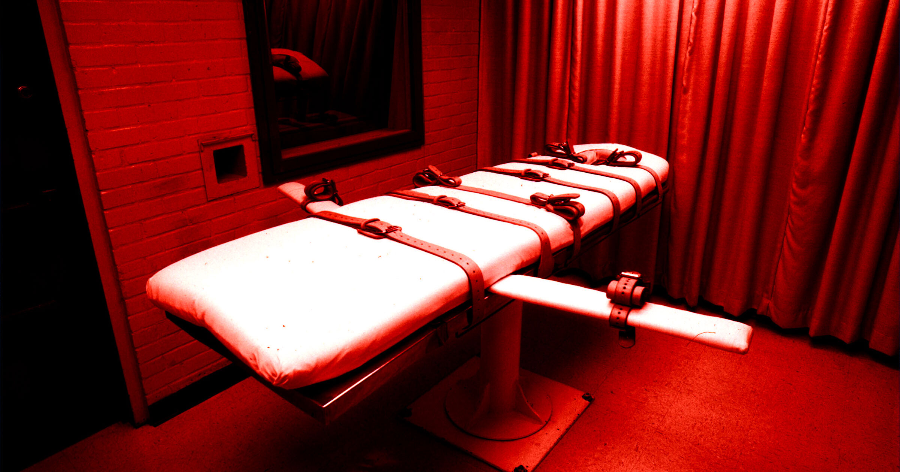

# 注射死刑的残忍程度令人难以想象

> 麻醉科医生Joel Zivot在《纽约时报》撰文指出,注射死刑是一种极其残酷的处死方式:戊巴比妥钠会造成严重化学烧伤,尸检显示多数囚犯可能如同溺水般死去。

戊巴比妥钠的pH介于9.8至11之间,与家用氨水相近,一旦注错便会造成化学烧伤。

## 被包装成“人道”的处死方式

自俄克拉何马州议员1977年制定注射死刑方案以来,美国各州纷纷采用,把它说成是比绞刑和电椅更有效甚至更人道的替代方式。

然而据死刑信息中心统计,美国迄今共执行1492例注射死刑。事实表明,用化学注射夺人性命是一种极其残忍的方式。麻醉科医生Joel Zivot在《纽约时报》的新专栏中主张,现在早该把注射死刑当作它名副其实的、反人类的残酷罪行来看待了。

## 派克案中的痛苦

Zivot对此深有体会——他是囚犯Christa Pike的医生,后者原定上周被处决。他曾警告派克的律师,她患有某些疾病,可能在注射死刑中经历痛苦而残忍的死亡。律师据此反对用巴比妥类药物戊巴比妥钠处死她,但无济于事。

处决照常进行,而这些疾病引发的并发症迫使狱方给她注射了两次剂量。她在极度痛苦中活了下来。“注射戊巴比妥钠后,她的手臂变成紫色,”Zivot写道,“律师报告注射部位出现水泡与灼烧。这显示部分药物因静脉输液失败进入了手臂组织而非血液。”

## 如同溺水而非安睡

由于戊巴比妥钠碱性极强(pH介于9.8至11,与家用氨水相近),注射过程中任何失误都会给受刑者带来痛苦的后果。“注入组织时,它会造成严重的化学烧伤,”Zivot写道,“在派克女士的案例中,进入她大脑的药量似乎足以让她深度镇静,却不足以让她停止呼吸。”当地媒体Fox12报道,派克甚至问狱警“本该是这种感觉吗”。

即便狱方当时找到了她的静脉,证据也显示戊巴比妥钠致死是一件恐怖的事。“我审阅过200多名注射死刑犯的尸检,”Zivot解释说,“绝大多数囚犯的肺部积满液体,气道常带泡沫。这是肺水肿的迹象,意味着他们可能感觉自己像在溺水,哪怕有些人死时看上去很平静。”“在国家手中,戊巴比妥钠是毒药,”他写道,“它不是止痛药,当国家注射它时,没人能说清囚犯何时不再感到疼痛。”

自俄克拉何马州近50年前把这套方案定为全美标准以来,已有75人与派克一样遭遇了创伤性的失败处决。鉴于授权注射死刑的28个州并不急于终止这一野蛮做法,Zivot说它们至少应当诚实、透明地承认这种方式究竟有多残忍。“有些州已经转向氮气和行刑队,”他说,而“Christa Pike请求被绞死。我并不赞同这些方法,但它们至少不假装自己是医学。”

