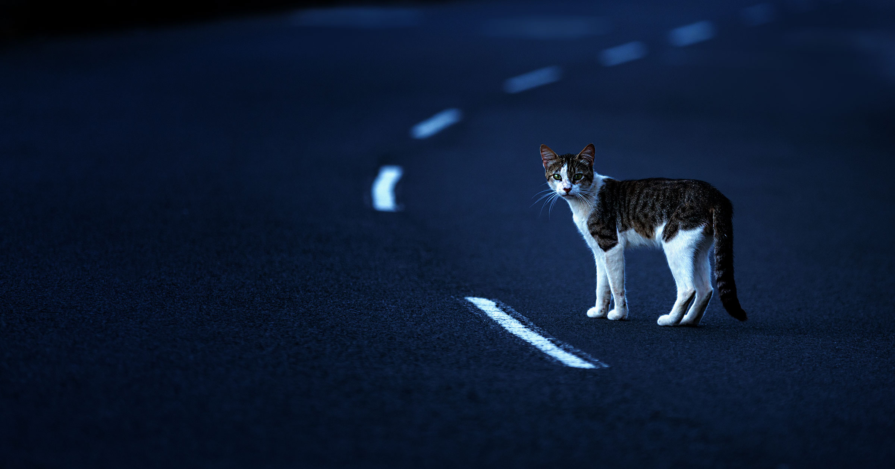

# 马斯克承认特斯拉Robotaxi夜间难被信任

> 马斯克宣布奥斯汀Robotaxi运营时间延长至晚间11点,理由是“夜间难以看清宠物,试图避免在黑漆漆的路面撞到灰猫”,这恰好暴露了特斯拉不装激光雷达与雷达传感器的短板。

马斯克称延长运营时间是“为了避免在黑暗中撞到灰猫”,而激光雷达本可轻松识别这类目标。

## 坚持纯视觉路线

多年来,特斯拉CEO埃隆·马斯克一直坚称自动驾驶汽车不需要雷达或激光雷达(LIDAR),单靠摄像头系统即可。他称LIDAR是“徒劳之举”,甚至声称它和雷达会“因传感器冲突而降低安全性”。

但在2026年,那些采用这些传感器的自动驾驶竞争对手,仍对马斯克的电动车公司保持明显优势。

## “避免撞到灰猫”

日落之后,借助额外传感器在黑暗中看清路况要容易得多,而马斯克似乎仍在补上这一课。上周末,他宣布公司位于奥斯汀的Robotaxi系统运营时间“从晚10点延长至晚11点”。

“我们主要想解决的问题是,夜间宠物难以看清时不要撞到它们,”他写道,“字面意思就是尽量避免在黑暗中撞到灰柏油路上的灰猫。”这条推文再次凸显LIDAR和雷达传感器能轻松让特斯拉汽车占据优势——无论什么毛色的猫,即便与背景毫无视觉反差,也能被它们识别。

## 延长一小时的意义存疑

但马斯克真实意图如何,尚不明朗。Electrek指出,奥斯汀眼下日落才刚过晚7点,这意味着服务在10点还是11点结束其实没多大差别——那个时段天不会更黑。

尽管马斯克一如既往地对Robotaxi的铺开大放豪言,但在奥斯汀乃至其他美国城市扩大运营都极其艰难。特斯拉遭遇重大监管障碍,尤其是其无方向盘、无踏板的Cybercab。在奥斯汀,采用LIDAR与雷达传感器的竞争对手Waymo,车队规模远胜特斯拉。但即便对Waymo而言,流浪猫仍是棘手问题:去年一只名叫KitKat的虎斑猫被一辆Waymo碾死,是好几只命丧自动驾驶车轮胎下的社区宠儿之一。

