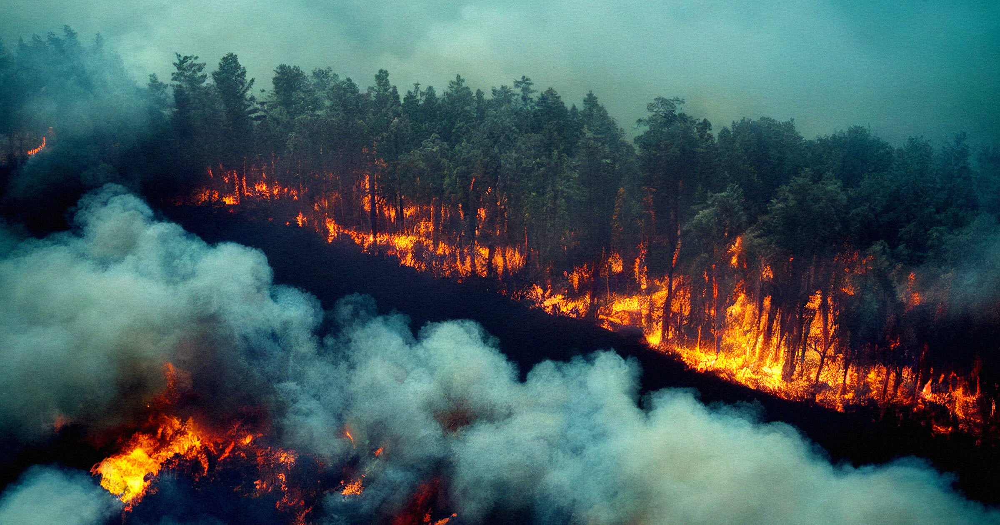

# 地球在烧 告石油巨头的气候大案打到最高法院

> 2026年8月是非洲和北美有记录以来最热的8月、地球史上第二热的8月，科罗拉多州博尔德县起诉Suncor与埃克森美孚的气候案就在此时进入最高法院。

在破纪录的高温中，气候问责走向最高法院。

## 破纪录的高温与山火

2026年8月是非洲和北美有记录以来最热的8月，也是地球有记录以来第二热的8月。受极端高温驱使，过去一年美国一国就有超过6.2万场山火，烧毁超过900万英亩土地——无论火灾数量还是平均过火面积，都远超十年均值，据美国国家跨部门消防中心的数据。

这就是21世纪最重要的气候诉讼之一走向美国最高法院时的背景板。

## 案件进入最高法院

据气候记者Clark Mindock在Landmark刊物的报道，大法官们正在就Suncor Energy诉博尔德县一案进行口头辩论，其结果可能开启一个企业责任的“黑暗时代”。

这起案件由科罗拉多州博尔德县的县委员提起，在科罗拉多州法院起诉石油巨头Suncor和埃克森美孚，指控气候变化给该县居民带来沉重的经济负担。如果博尔德在最高法院胜诉，它将得以继续在州法院推进诉讼，争取在州一级为纳税人谋求救济。

## 两种结局的连锁反应

但据Landmark，若这个国家的最高法院判石油公司胜诉，这一判例将在全国产生连锁效应，很可能导致数十起类似案件被驳回。

实际上，这起诉讼是对美国民众能否制约化石燃料巨头权力的一次关键考验——这些公司的产品与服务正不成比例地伤害环境。如果最高法院站到石油公司一边，就意味着关掉气候问责仅剩的为数不多的法律通道之一。

## “凌驾于法律之上”的警告

正如气候诚信中心的传播总监Mike Meno对Landmark所说：“如果有一天我们醒来，发现地球上一些最大、最有害的企业凌驾于法律之上，那将造成巨大的破坏。”

