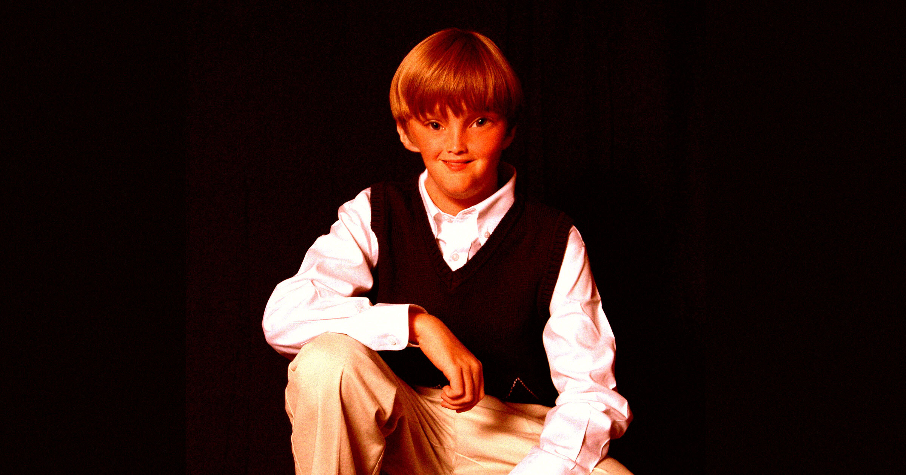

# 家长用AI给孩子生成学校证件照 不愿再付费

> 越来越多家长把孩子站在纯色墙前的手机照片丢给ChatGPT生成“学校照”，省下每套25到60美元的拍摄费，却把孩子肖像交给了企业AI模型。

省下几十美元，交出的却是孩子的肖像。

## 省钱的AI土法子

既然能用AI给孩子的肖像加料，何必再花钱买学校摄影师拍的那些千篇一律的大头照。

据Fast Company，这是如今越来越多家长在打的算盘：借助ChatGPT之类的生成式AI工具，赶制学校照相日。家长们在社交媒体上炫耀，AI帮他们在孩子的学校照片套系上省下了多少钱——通常每套在25到60美元之间。

## 操作其实很简单

网红Carlie Bond的一条TikTok展示了这个招数：家长先让孩子站到一面纯色墙前用手机拍几张照，再把这些照片丢进ChatGPT，提示词是“保持他们完全不变，但让它看起来像一张学校照”。

ChatGPT随后会加上一个平淡乏味的背景，让人想起Lifetouch这类批量拍摄公司出品的学校照。“我们自己拍了，让我好朋友Chat帮了忙，”Bond炫耀道，“说实话……我对成品并不生气。”有TikTok用户回复：“ChatGPT赢麻了。”

## 还有人拿AI去水印

Fast Company观察到的另一些家长，则用AI来“去除”学校样照扫描件上的水印——否则他们得花钱才能把图弄干净。

## 一旦上传 就再也拿不回来

当然，这两种用法都意味着把一个孩子的容貌喂给了一家企业的AI模型，而这些图像几乎肯定会被用来训练下一代AI工具。说白了，家长一旦上传那些照片，就再也拿不回来。考虑到其中的伦理和隐私风险，想省下学校照这点钱的家长，或许不如干脆自己拍，别碰ChatGPT。

