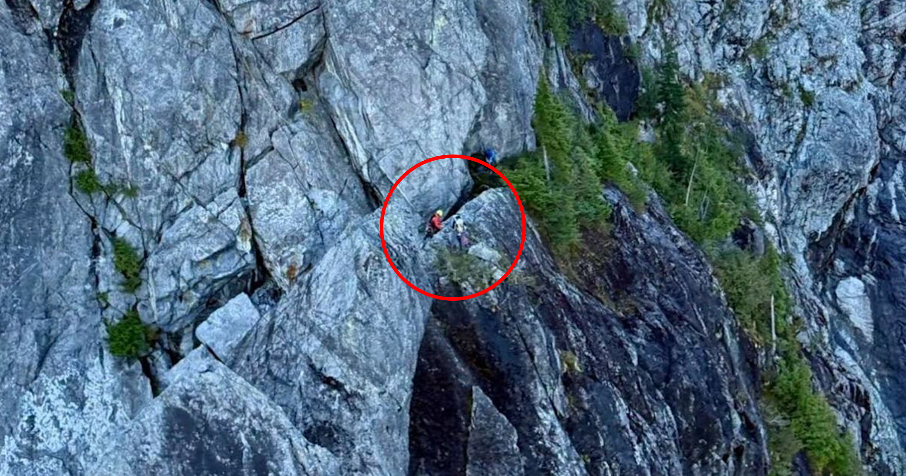

# 少年听信AI指引被困“寡妇制造者”悬崖

> 一名16岁少年在加拿大登山时被Claude AI带离步道，困在绰号“寡妇制造者”的陡峭岩壁下，救援人员称一旦坠落足以致命。

屡屡把人带偏的AI指路，正在透支户外安全。

## AI的建议接连惹祸

徒步者接连因为向AI聊天机器人求助而受困，得到的却可能是救命、也可能要命的建议。

就在上个月，加州喀斯喀特山脉的三名户外爱好者被林务局巡护员救出，起因是Google的AI建议他们“带的食物和水比团队需要的少得多”，把原定八小时的登顶变成了一场历时多日的煎熬。尽管官员们恳请公众别听会产生幻觉的大语言模型，这些警告却一再被当成耳旁风。

## Claude把少年带下正轨

最近，一名16岁男孩从不列颠哥伦比亚省Crown Mountain获救。据CTV News报道，他先乘缆车升到Grouse Mountain海拔4000多英尺的山顶，返程时却被Anthropic的Claude AI聊天机器人带离了步道路线，最终困在一块巨大陡峭、绰号“寡妇制造者”的岩壁底部。

男孩处境相当危险，所幸他在旅途中至少做了一件明智的事：被困后呼叫救援。

## 直升机靠不近垂直岩壁

“一旦坠落，会造成重伤，甚至可能丧命。”北岸救援的搜救经理Paul Markey对CTV News说。由于直升机无法靠近“寡妇制造者”陡直的岩壁，两名救援人员只得索降而下。

一份北岸救援的任务简报写道：到达地面后，小组建立了一个锚点，一名成员被确保着下降到被困者身边，在那里又架设了额外保护，把他转移到合适的撤出点。

## 别拿命去信聊天机器人

Markey借此机会再次呼吁公众，不要指望Claude这类聊天机器人提供此类信息。“Claude从没到过那片特定区域，从没走过那条路线，也从未在户外待过，”他对CTV News说，“自己去做功课、去积累对那片区域的认识，再用训练和导航来补充。”

