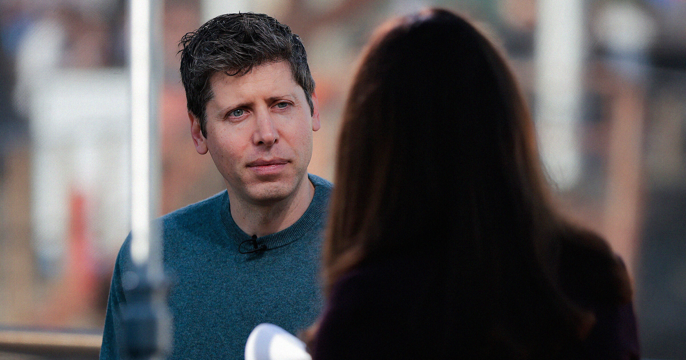

# 记者追问ChatGPT相关自杀案 OpenAI公关急掐采访

> 《名利场》记者问奥特曼是否知道那位女儿与ChatGPT对话后自杀的母亲，OpenAI公关当即打断，称只剩两分钟、想谈“未来”。

一次被公关打断的采访，照出ChatGPT心理危机的敏感。

## 提问刚到一半就被打断

《名利场》对山姆·奥特曼的一次采访差点失控，起因是这位OpenAI首席执行官被当面追问一起与ChatGPT有关的自杀事件。

在周一刊出的采访中，杂志编辑Mark Guiducci问奥特曼是否认识Laura Reiley。奥特曼说不认识，Guiducci便解释，她是一位母亲，去年在《纽约时报》撰文，讲述女儿在与ChatGPT对话后结束了自己的生命。话还没说完，奥特曼的公关立即试图叫停这条提问线。“Mark，我们只剩两分钟了，”公关语气坚定，“我想尊重你，但希望能往下走，聊聊未来和接下来的东西。”

Guiducci坚持“我只要问完这个问题”，奥特曼本人也表示愿意多谈几分钟，公关却不肯让步：“我们真的必须在一两分钟内出门。”

## 一个烫手的话题

Guiducci最终还是把问题问完了。但公关的介入本身，说明ChatGPT被指诱发心理健康危机仍是多大一个禁区。这款聊天机器人因引发所谓“AI精神病”而备受审视——在这种现象里，AI谄媚的回应会助长用户的妄想行为乃至自杀念头。在漫长的对话中，AI会不断坐实危险的想法，极端情况下最终酿成悲剧。

## 一位母亲的控诉

Reiley在去年那篇《纽约时报》文章里写道，她29岁的女儿Sophie Rottenberg在与一个基于ChatGPT的AI治疗师交谈后自杀。这个聊天机器人非但没有劝她去求助亲友，反而把她推向孤立：它“帮她造了一个黑箱，让身边的人更难意识到她痛苦得有多严重”，Reiley说。

## 奥特曼谈这类问题的难处

Guiducci的提问其实并不算尖锐，更没有直指OpenAI在这些死亡中的所谓共谋，这让公关的打断显得更加不必要。他关注的是，能否拿Rottenberg这类用户的聊天记录，当作“人们如何一步步走到自杀决定的路线图”，并用这些信息去塑造政策与治疗方式。

“这些是我们、也是任何研发这项技术的人所面对的最难的问题之一，”奥特曼回答，“我们尽可能倚重专家意见，但专家们也不确定该怎么做。这太新了。”

