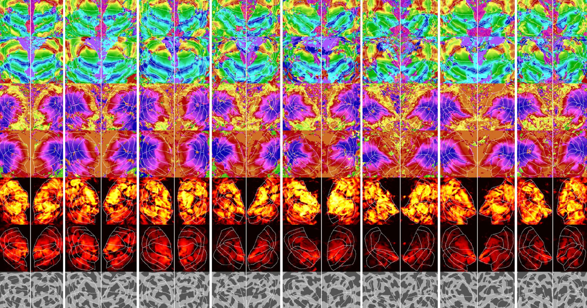

# 新 AI 能从脑扫描里“读出”你在看什么

> 魏茨曼科学研究所的团队开发出一款 AI，能通过分析脑扫描预测你正在看什么，并生成相当逼真的图像复现。研究者用“反向”模型绕开数据不足的难题，但连他们自己也承认会出错——比如把浴缸里的狗重建成了浴缸里的山羊。

“脑解码”正从科幻走向实验室。

## “读心”工具，还差一口气

是时候了解一下“脑隐私”了，因为它可能很快就要像渡渡鸟一样消失。研究人员开发出一款 AI 工具，能通过分析脑扫描预测你正在看什么，并生成一幅相当逼真的图像来复现你脑中的画面。说它是“读心”工具并不算太夸张，虽然它目前的流畅程度还远不及科幻小说里那样。

“结果看起来非常惊人，”加州大学圣塔芭芭拉分校的神经科学家 Tommy Sprague 对《麻省理工科技评论》说。“但如果存在一种能偷偷提取你正在想什么的方法，那么……150 年的科幻随时可能成真，这在很多方面都令人担忧。”

## 用“反向模型”绕开数据瓶颈

这并不是第一项用脑扫描重建脑海中画面的研究。但开发该工具的魏茨曼科学研究所的 Michal Irani 表示，他们这项工作能生成更高保真度的画面复现。

研究中，团队用公开数据集里的脑扫描来训练模型——8 名受试者观看数千张图像时被记录下脑活动。与更早的扫描不同，他们专门挑选了分辨率足够高的新数据，能显示小到一立方毫米的神经元体积。由此得到的“脑解码器”分两支：一支预测图像的结构，另一支预测内容，二者合力，让一个扩散模型把受试者看到的东西重建出来。

但真正的难题在于数据量：要精调模型就得喂更多数据，而他们所需的那种特定脑扫描根本不够用。为此，研究者训练了一个“反向”模型——从人正在看的图像去预测脑活动。这个“编码器”可以针对每张具体图像，吐出大量预测的脑扫描，再交给解码器据此重建图像。如此反复，直到重建结果与原图越来越接近，也就不再需要只用真实扫描中展示过的图像。

## 会出错，也会带来伦理难题

它并不完美。“当然会有失败，”Irani 对杂志说，并举例：工具把浴缸里的一只狗，重建成了浴缸里的一只山羊。

一面是，这项技术可能成为无法身体交流的瘫痪者的游戏规则改变者；另一面，它有朝一日可能宣告“脑隐私”的终结。

## 脑隐私的黄昏？

目前这套方法还需要庞大而昂贵的 fMRI 机器拍出的高分辨率脑扫描。但如果同样的技术被用在可穿戴 EEG 设备上，那将是“游戏规则的改变者”——慕尼黑工业大学的神经科学家兼哲学家 Marcello Ienca 对《麻省理工科技评论》说。这类设备可以针对你的大脑进行校准，理论上，一家公司就能在未经同意的情况下从你脑中提取信息。

“我毫不怀疑这是一项善意的研究，但显然，它也可能被挪用于伦理和社会层面有问题的商业用途，”他对该刊说。

