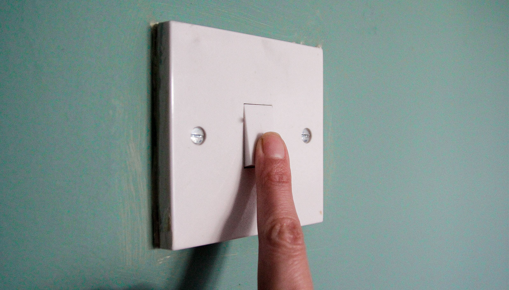

# 大脑深处有个开关，能直接关掉慢性疼痛

> 圣路易斯华盛顿大学在小鼠大脑里找到了一个"疼痛刹车"：神经损伤会把它翻转成慢性疼痛的发动机，而重新打开它就能止痛，且避开阿片类药物的全身副作用。

小鼠大脑中的"蓝斑"区域藏着天然的疼痛刹车。

科学家在小鼠大脑里找到了一个能关掉慢性疼痛的开关。

在大脑最深处，一小簇神经细胞充当着身体天然的止痛药，把顺着脊髓上行、传向大脑的疼痛信号调低。但神经损伤会把这套系统翻转成一架慢性疼痛的"超频发动机"。

现在，圣路易斯华盛顿大学医学院的研究者弄清了这个开关为什么会被翻转，以及怎么把它关掉。

他们发现，在小鼠身上，大脑主要警觉与应激中枢表面的一些受体，充当着疼痛的"生物刹车"。这些受体此前已知会影响该脑区的应激反应，现在还被发现能在神经损伤后关掉那台"疼痛发动机"，缓解慢性神经痛。

发表在《当代生物学》上的这项研究，为开发专门瞄准这个叫"蓝斑"（locus coeruleus）脑区的疗法打开了新门。

"数百万成年人饱受神经损伤引起的慢性神经痛折磨，"该研究的资深作者、华盛顿大学医学院临床药理中心副教授 Jordan McCall 说，"这种疼痛很难治，传统阿片类药物会绑定全身上下的受体，常常带来副作用、耐药和成瘾风险。弄清蓝斑里这些局部受体怎么当'守门人'，才可能带来更有针对性、更有效、风险更小的止痛疗法。"

神经痛发生在受损的神经纤维不停地向大脑发送错乱信号时，引起刺痛、刀割或灼烧感。糖尿病、病毒感染、神经受压等都常引发它。

为了弄清怎么阻断这些信号，McCall 的团队（共同第一作者为博士后研究员 Chao-Cheng Kuo 和 former 研究生 Makenzie R. Norris）把目光投向蓝斑——一个已被证明参与疼痛调节的脑区。

首先，他们确认了神经损伤会把这一区域变成疼痛的活跃驱动者。当他们在小鼠身上暂时关掉蓝斑的脑细胞，观察到模型化神经痛小鼠对触摸和热的敏感度，比健康小鼠更低。

接着，他们盯上蓝斑脑细胞中响应阿片类物质的受体，尤其是一类叫"μ"的阿片受体。μ 受体散布在大脑和脊髓各处，当身体自身产生的阿片类物质，或吗啡、芬太尼这类合成物落进它的"口袋"，整个神经系统的疼痛就会减轻。因为蓝斑里塞满了这种受体，研究者怀疑它们在疼痛调节里扮演重要角色。

他们在患神经痛的小鼠身上，只删掉蓝斑脑细胞上的 μ 受体。没了受体，这些小鼠对触摸和热的敏感度，比还保留 μ 受体的小鼠更高。把受体恢复到同样的神经元上，超敏反应就逆转了——疼痛被有效关掉。

这个结果说明，慢性疼痛可能正在削弱 μ 受体压制蓝斑脑细胞活动的能力。基于此，研究者正在探索怎么操控蓝斑，又不波及其他神经系统的受体。通过设计专门激活该脑区 μ 受体的疗法，他们希望为慢性神经痛开辟一条强力、且副作用更小的出路。
