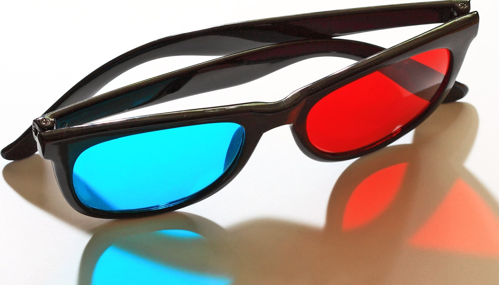

# 自由派和保守派都讲道德，分歧只在：谁算"受害者"

> 一项覆盖 6000 多人的研究发现，左右两派对"什么是对错"其实高度一致，真正的分歧在于——他们各自觉得谁更容易受伤害、更该被保护。

研究揭示：左右派的分歧在于"谁算受害者"。

大家心里那套对错的道德罗盘其实差不多，但自由派和保守派真正吵起来的地方，是"谁才算受害者"——这是一项新研究得出的结论。

发表在《人格与社会心理学公报》上的这项研究，提出了一个叫"脆弱性预设"（assumptions of vulnerability）的概念：人们心里对谁特别容易受到伤害、被亏待、被当成受害者有一套预设，而正是这套预设，解释了为什么左右两边会得出如此不同的道德结论。

"我们都关心保护弱者不受伤害，但对谁特别容易受害，我们做了不一样的假设，"研究合著者、布法罗大学管理学院组织与人力资源助理教授 Daniela Goya-Tocchetto 说。

"自由派倾向于把世界看成两个清晰的阵营：一类非常脆弱，一类不那么脆弱；而保守派倾向于认为，不管属于哪个群体，大家受伤害的风险都差不多。"

为了衡量人们对脆弱性的看法，以及它和政治立场、道德判断的联系，研究者做了 12 项研究，总共超过 6000 名参与者，手段包括问卷调查、实验、一项内隐反应时测试（瞬间测出隐藏信念），以及真实的慈善捐赠选择。

结果发现，自由派和保守派在"保护易受伤害的群体和理念"这一点上大体达成一致。而且，一个人越觉得某人或某物脆弱，就越觉得无论是实际还是象征性地伤害它都不道德。

差别出在：他们各自觉得谁和什么才脆弱。自由派认为环境和少数群体（比如移民、少数族裔）比有权势的人（比如 CEO）或宗教信条与象征（比如圣经、教堂）脆弱得多。保守派则把这些群体和理念都看得同样脆弱。

作者提出，这种对"什么道德、什么不道德"的共识，可以成为讨论分歧议题的一个实际出发点。

"既然分歧来自对'谁脆弱'的不同假设，而不是根本不同的道德观，那么减少政治冲突的努力，可能更应该直接去处理人们对脆弱性的认知，而不是试图改变一个人的底层价值观——而那本来就没差那么多，"Goya-Tocchetto 说。

"宣传、媒体框架或教育，只要突出某个对象的脆弱或不可欺，就能实实在在地改变人们对某个议题或行为的判断。"
