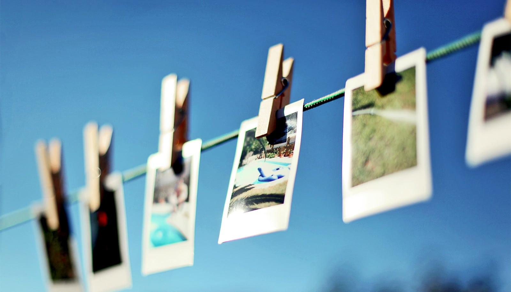

# 你回忆的方式，本身就在改写记忆

> 莱斯大学研究发现，每次提取一段记忆，大脑对它的表征都会带上"这次是怎么想起来的"痕迹。记忆不是固定档案，而是越用越在变的活物。

记忆每次被提取，都会留下使用方式的痕迹。

新研究表明，每次我们调出一段信息，回想它的方式会影响大脑下一次怎么表征它。

我们往往把记忆想成存在脑子里、需要时再取出来的固定资源。但记忆可能远比这动态。

"我们的记忆远不只是按需查阅的固定资源，"莱斯大学 Marc Coutanche 说，"它是动态、可适应的。提取记忆是在主动更新记忆，而不只是'回放'它。"

Coutanche 最近以心理科学副教授身份加入莱斯，他和四年级博士生 Amy Qi 探究了一个问题：人们提取信息的方式，会不会留下一道痕迹，在下次提取时被检测到。

他们的发现发表在《认知神经科学杂志》上。

想象一下回忆你的狗。你可能聚焦某个具体细节，比如它毛色的花纹；另一次，你可能只把它想成"一条狗"；或者你会想到它作为家庭成员的更大角色。Coutanche 和 Qi 想知道，这些不同的提取方式，会不会影响大脑之后发生的事。

为了弄清，参与者在学习成对图片和陌生荷兰语单词时，接受了功能性磁共振（fMRI）扫描。研究者之后用不同方式提示他们回忆这些物体：聚焦某个具体特征、一个更宽的类别，或一个主题。

再次测试时，不管之前怎么想的，参与者记住信息的能力都差不多好。

但他们的大脑活动讲了一个不同的故事。

"我觉得最有趣的是，我们证明了记忆似乎会携带'它之前被怎么用过'的痕迹，"Qi 说。

"和记忆相关的神经活动，不仅反映了参与者当下的动作，也反映了这段记忆之前被怎么提取过。"

研究者发现，按类别去想物体，会让不同物体在视觉处理相关脑区的神经模式变得更像；而聚焦单个物体，则会让它的神经模式在语言处理相关脑区更独特。

这些发现加深了一种日益清晰的认识：记忆是会随着使用而改变的，而不是一份单纯存着、回放的死档案。

研究也展示了计算方法如何能揭示行为本身显现不出的记忆侧面。

Coutanche 和 Qi 把 fMRI 和机器学习技术结合，寻找脑活动中细微的模式。这些方法让他们能检测到信息之前被怎么提取过——即便参与者在记忆测试上表现相近——涉及的脑区包括海马体和视觉皮层。

"如果不借助这类技术去看那些细微的活动模式，我们可能就完全错过了这些发现，"Coutanche 说。

"像这样的计算方法，让我们能以真正洞见大脑如何记忆的方式，去检测和理解那些细微的活动模式。"
