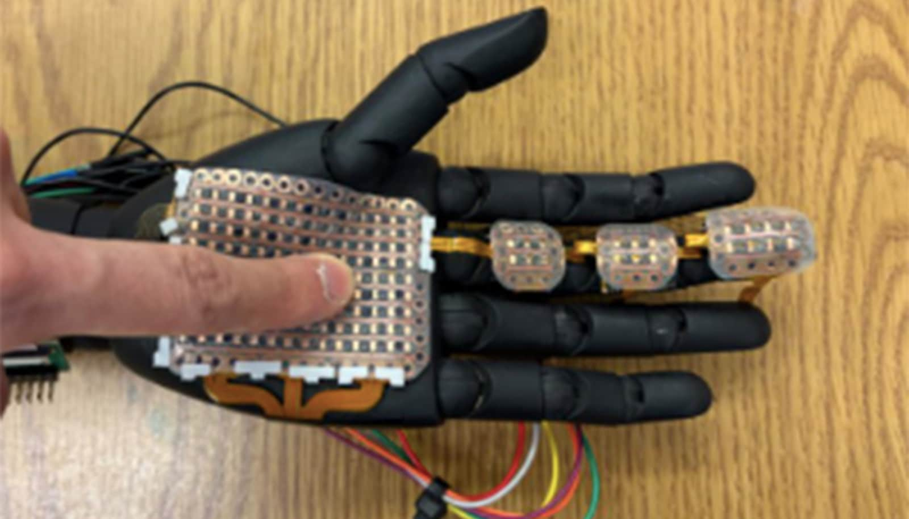

# 能给假肢"摸"出温度和压力的电子皮肤，灵敏度高出现有十倍

> 华盛顿州立大学做出一种可定制、能同时感知压力和温度的电子皮肤，灵敏度是市面商用传感手套的十倍，还能像乐高一样拼接贴合任意形状的残肢。

假肢电子皮肤能感知温度与压力。

一种带感知系统、能同时探测压力和温度的电子皮肤，将来或能帮助截肢者让假肢"找回"感觉。

这项由华盛顿州立大学研究者主导、发表在《Cell Reports Physical Science》上的工作，传感精细度是 currently 商用传感手套的十倍。

"这种方法让医疗级电子皮肤的生产平民化了，让先进的触觉反馈能真正大规模进入临床，"机械与材料工程学院研究生、论文第一作者 Hongyi Shen 说。

"这项工作为在假肢上实现兼具感知与触觉刺激功能的完整仿生皮肤，打下了关键基础。"

触觉刺激复制的是"触摸"这种感觉。给截肢者哪怕部分触觉，都能大幅提升他们完成任务的能力。虽然现在已有电子皮肤，但价格贵、分辨率低，还常常不合身、只覆盖一小块区域。事实上，电子皮肤越做成定制形状，传感能力反而越差。而且，传感阵列产生的大量数据，意味着它们没法很好地实时工作。

"这些设备常常被迫在舒适度和机械可靠性之间妥协，"Shen 说。

WSU 研究者开发了一套可定制的假肢传感系统，能贴合肢体的自由形状，并在传感能力上更好地模仿真人皮肤。他们做的传感模块是薄层"三明治"，内嵌温度和压力传感器。这些元件能实现类人的触觉感知，可靠地识别表面纹理和材料属性。

研究者用了一种"扫描—建模—打印"的制造方法，让高密度传感和个性化 3D 制造能同时进行。

"扫描仪基本先扫描假肢，然后基于几何形状，我们把传感器作为多模态传感系统按这个形状排布，"机械与材料工程学院助理教授、论文通讯作者 Kaiyan Qiu 说。

"这让我们的传感系统能无缝覆盖假肢上的自由形状区域。"

这些传感器精准又可靠，能在平面或曲面上以高密度同时测出压力和温度。模块之间不用胶水，而是像乐高一样卡扣拼接。

"我们的主制造法用 3D 打印和激光切割，相对简单，所以成本可能较低、也方便，"Qiu 说。

这个项目部分由 WSU 的"下一代机器人 NSF 研究培训项目（NRT-LEAD）"支持，负责人是机械与材料工程学院教授兼主任 Prashanta Dutta，他也是论文通讯作者之一。另有 Qiu 的 WSU 启动资金和 Cougar Cage 基金提供支持。

研究者已向 WSU 研究创新与创业办公室提交了一份临时专利的发明披露。他们还在开发一种执行器，最终把电子皮肤的传感信号转化，让截肢者知道自己在摸什么——那需要把传感信号转成刺激，并传递给附近神经。
