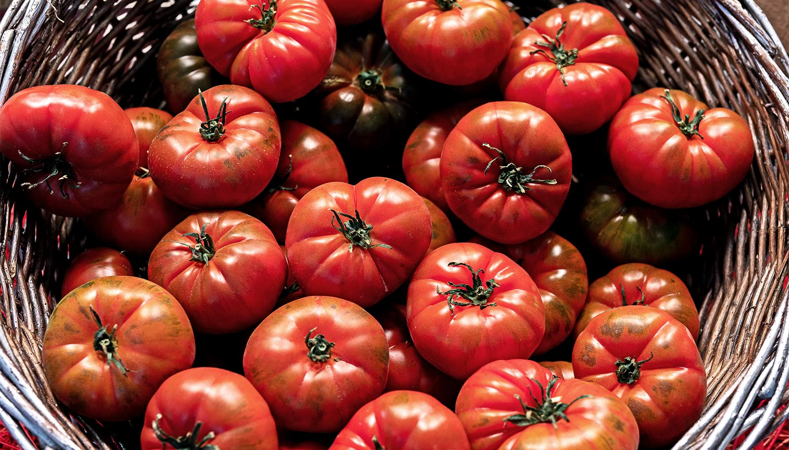

# 番茄里一种无色化合物，或能帮肝脏挡住脂肪肝

> 番茄里大名鼎鼎的番茄红素之外，塔夫茨大学发现它的" colorless 前身"植物烯（phytoene）也能护肝。吃六个月的实验小鼠，脂肪肝明显更轻——它靠激活肝脏代谢蛋白、烧掉多余脂肪起作用。

番茄中的植物烯或能预防脂肪肝。

一项新研究显示，番茄里一种不太为人所知的化合物，可能有助于预防脂肪肝——这种病影响着超过三分之一的美国成年人。

几十年来，红色色素番茄红素一直被视为番茄里的明星营养素。

但塔夫茨大学的新研究提示，植物烯（phytoene，番茄红素的一种无色前体）也可能贡献了番茄对一种慢性脂肪肝的保护作用。

发表在《分子营养与食品科学》上的这项研究发现，喂食植物烯的小鼠，比吃同样不健康饮食、却没有这化合物的小鼠，发展出的脂肪肝程度明显更轻。虽然成熟红番茄里看不见它，但植物烯是植物转化成番茄红素和其它类胡萝卜素——赋予许多果蔬红、黄、橙色的天然原料。

美国估计有多达 1 亿成年人——以及高达 75% 的肥胖或糖尿病美国人——患有代谢功能障碍相关的脂肪肝。这种情况下，太多脂肪在肝细胞里堆积。久而久之，过量脂肪积累会引发肝脏炎症和损伤，更严重的会发展成叫肝硬化的肝瘢痕。

科学家多年来知道番茄可能护肝。但在动物研究里，番茄粉护肝的效果胜过纯番茄红素，提示番茄里其它化合物也可能贡献这些益处。

"番茄和番茄制品里，番茄红素和植物烯都大量存在，"该研究第一作者、塔夫茨大学弗里德曼营养科学与政策学院博士生 Na Youn Lee 说，"但我们根据既往研究知道，植物烯其实更容易被身体吸收。"

在这项新研究里，研究者给两组小鼠喂了六个月高精制碳水化合物饮食，模拟与人类脂肪肝相关的饮食模式，包括大量摄入含糖食物和饮料。其中一半小鼠还额外补充植物烯，剂量相当于人每天吃约三到四个中等大小生番茄，或 100 克番茄膏——也就是略多于三分之一杯。

团队随后比较了两组小鼠的肝脏健康、代谢和肠道菌群。科学家还考察了雄性和雌性小鼠之间、以及正常小鼠和缺乏两种把类胡萝卜素转化为生物活性代谢物的酶的小鼠之间的差异。

补充植物烯的小鼠，发展出的脂肪肝比没补充的轻得多。植物烯似乎不是通过改肠道菌群起作用，而是激活了几个调节肝脏代谢的关键蛋白，帮肝脏把多余脂肪烧掉供能，而不是让它堆积。

缺乏代谢植物烯所需酶的小鼠，体内积累了高得多的化合物，却没得到同等的护肝保护。这个发现提示，护肝效应可能来自身体分解植物烯时产生的更小的化合物。因为人在代谢植物烯的酶上可能存在基因差异，还需要更多研究去识别这些代谢物，并确定是否有些人比其他人更能从中受益。

研究还发现雌性在肝脏里积累的植物烯比雄性多，提示性别可能影响身体吸收或代谢该化合物的方式。作者指出，未来研究可以探索这些差异是否影响植物烯护肝的能力。

"我们的发现意义广泛，因为植物烯不仅大量存在于黄、橙、红番茄里，也存在于许多常见果蔬中，包括胡萝卜、红椒、粉红葡萄柚、西瓜和杏，"塔夫茨大学高级科学家、研究资深作者 Xiang-Dong Wang 说。

"如果进一步的研究验证我们的发现，鼓励人们多吃富含植物烯的果蔬，可能是一个有用的策略，帮助预防代谢性肝病，或延缓它在高风险人群中的进展。"
