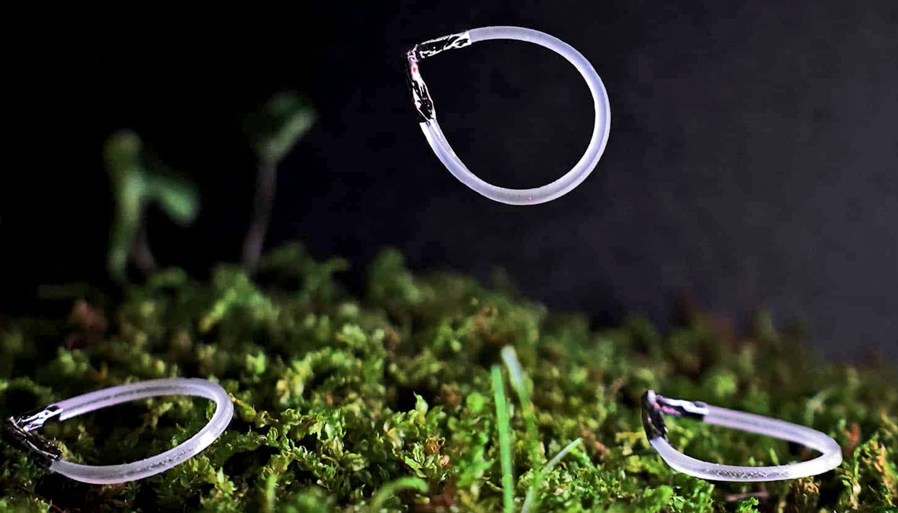

# 会一直跳的软体机器人，红外光一照就起飞

> 北卡州立大学做出泪滴形软体“环形跳跃者”：红外光一照就扭转储能、到临界点猛然释放，V形端向下一拍把自己弹起，落地回形后继续跳，无需复位。

泪滴形软体机器人在红外光下持续跳跃

## 不用复位，自己就会跳

这款机器人由液晶弹性体薄带做成泪滴形，一端装一个V形铝管。红外灯一照，薄带表面收缩并带动旋转；V形端的刚性约束让薄带越拧越紧，弹性势能不断累积，直到越过临界点——V形端猛然向下拍击地面，泪滴被弹向空中。落地后薄带回弹到原形，只要光还在，下一跳立刻开始。

通讯作者、北卡州立机械与航空工程教授Jie Yin说：“这个‘环形跳跃者’设计非常简单，我们用扭转储存弹性能量再一次性释放，结构本身让它无需在两次跳跃间复位，它自己会复位。”

## 一个角度，决定爬、跳还是直冲

团队发现，V形的夹角就是“档位”：夹角120度时机器人只会向前爬；90度时向前跳；50度时则垂直跃起。第一作者、博士后Fangjie Qi说，单一几何参数就能切换运动模态。

质心也有讲究：在泪滴圆端加一点配重，像跳水运动员压低重心俯冲，能让前跳更远、更稳。

光强同样关键：太弱跳不起来，太强则会跳得失控。合适的光强下，机器人能在红外光持续照射时保持节律性跳跃，展示了一种全新的自复位跳跃机制，为软体机器人的机动性提供了极简而可靠的方案。
