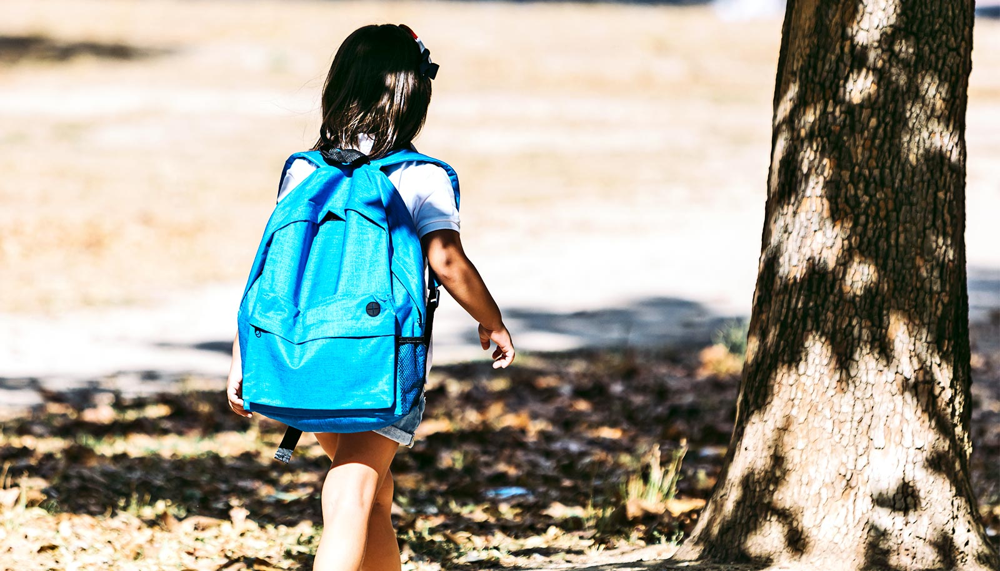

# 全美44%中小学毗邻环境危害点，300万儿童就读风险学区

> 布朗大学一项发表于《美国国家科学院院刊》的研究发现，全美有超300万名中小学生，就读学校距EPA登记的环境危害场地不到400米；若把距离放宽到1英里，比例高达44%。

美国中小学选址与环境风险的关联首次被全国尺度摸底，结果令人不安。

## 8%在400米内，44%在1英里内

研究团队以EPA追踪的Superfund（超级基金）场地、棕地（brownfield）以及有毒物质排放清单（TRI）设施为基准，叠加全美中小学点位。结果显示，8%的学校位于危害场地0.25英里（约400米）范围内，约44%的学校在1英里范围内——而已有研究表明，1英里内的暴露与健康、学业表现下滑相关。

“我们震惊于学校紧邻有毒场地和工业污染竟如此普遍。”论文共同作者、布朗大学教育与经济学教授Matthew Kraft说，“这是几乎每个社区、每个州都该担忧的问题。”

## 谁在承担更多风险

风险并非均摊。原住民、黑人、拉丁裔和低收入家庭的学生，进入“400米内”学校的概率分别高出124%、86%、43%和40%。研究者指出，工业设施历史上更倾向选址于政治和经济话语权较弱的边缘社区，学校随之被动承受了环境外部性。

地理上，城市学校暴露率最高（12.7%在400米内），其次是城镇（10.3%）；区域上，东北部和中西部高于西部和南部。

## 能做什么

研究者建议，精准识别“毗邻污染点”学校，可支撑更有针对性的空气/土壤/水质监测、场地修复、校舍现代化改造，以及面向学生、家庭和教职员工的健康风险沟通。

“我们希望这份覆盖数千所学校的描述性证据，能让决策者和校方更重视‘安全健康的学习环境’这件基础事。”Kraft表示。

论文由布朗大学Annenberg研究所研究员Sohil Malik和项目主任Grace Falken等共同完成。
