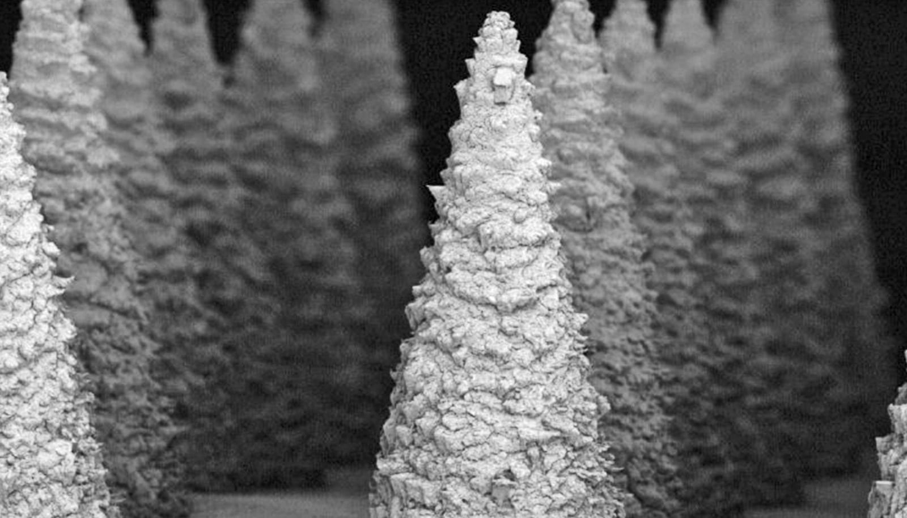

# 无痛微针贴片或可更早发现肾病，在家就能测

> 华盛顿大学圣路易斯分校团队在《Advanced Materials》报告了一种无痛微针贴片：贴在皮肤上即可捕捉NGAL等早期肾损伤标志物，且常温下可保存数周，未来有望实现家用或床旁监测。

肾病早期往往无症状，窗口期短，贴片想把检测提前数小时。

## 为什么需要它

肾病在早期几乎没有症状，等到出现不适往往已进展到中晚期。NGAL（中性粒细胞明胶酶相关脂质运载蛋白）在肾损伤后数小时内就会在血液中升高，是临床验证的早期标志物，但传统检测需抽血并依赖冷链，难以进入家庭或资源有限场景。

## 贴片怎么做到的

团队由机械工程与材料科学系教授Srikanth Singamaneni领衔，博士生Yixuan Wang等参与，核心是在微针表面用金属有机框架（MOF）包裹并固定抗NGAL抗体。微针刺入皮肤取样组织间液，MOF外壳在捕捉NGAL的同时保护抗体的生物活性，50℃下可稳定保存至4周而无需冷藏。

“这种MOF封装简单高效，让微针传感器更耐环境挑战，为居家或远程健康监测提供了可扩展的微创路径。”Singamaneni说。这是首次证明将生物分子封装于微针仍能保留其功能。

## 下一步

该贴片已在早期肾损伤检测中显示出良好灵敏度和定量能力，研究团队此前已开发过面向疾病标志物的微针平台，此次则着力提升灵敏度、拓宽检测范围并解决冷链痛点。合作方包括华盛顿大学医学院和德州农工大学，研究获NSF、NIH等资助。相关等离子体荧光技术已由学校技术管理办公室授权。

若后续临床验证顺利，贴一片、等一会儿、在家读数的肾病早筛，或将成为现实。
