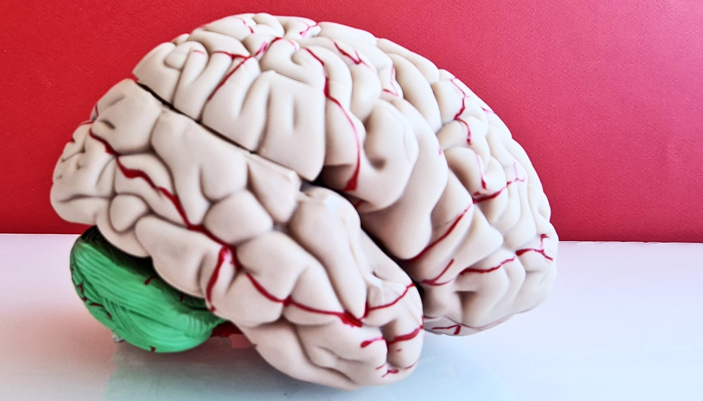

# 激光烧掉脑瘤，胶质母细胞瘤患者多活半年以上

> 华盛顿大学牵头分析787例脑肿瘤患者发现：用激光烧掉至少91%的胶质母细胞瘤，患者中位生存期可达2.1年，比传统开颅切除的1.5年多出半年，且住院仅需32小时。

激光间质热疗为胶质母细胞瘤患者带来新的生存希望

## 开颅之外，还有一束光

胶质母细胞瘤是成人最凶险的脑癌之一，标准方案是掀开颅骨切瘤，再辅以放化疗，创伤大、预后差。过去15年，神经外科多了一个微创选项——激光间质热疗（LITT）：在颅骨上钻一个几毫米的小孔，置入机器人控制的激光探针，在实时MRI引导下穿过脑组织直达肿瘤，激光发热“烧死”瘤细胞。

这套工具叫NeuroBlate，由Monteris Medical研发，2009年获FDA批准上市，目前主要用于复发、位置深或无法开颅的脑瘤。

华盛顿大学医学院Eric C. Leuthardt教授团队牵头，联合全美25个中心，对787例接受LITT的原发与转移性脑瘤患者进行了长达5年的前瞻性随访，试图回答：哪些患者最能从这束光中获益？

Leuthardt说：“我们的目标既是延长生存，也是改善生活质量。这项分析找到了通往最佳结局的关键因素。”

## 烧得够多、治得够早，才活得更久

结论很直接：烧掉的比例和治疗时机决定生存期。

对新诊断的胶质母细胞瘤患者，若激光清除了至少91%的肿瘤，诊断后中位生存期达到2.1年，而传统开颅切除约为1.5年。对于被判“无法手术”的患者，这意味着LITT不仅是补救手段，也可能作为一线工具被考虑。

对脑转移瘤（原发灶在别处、转移到脑）且既往接受过放疗的患者，研究发现“越小越早治”更划算。若在肿瘤尚小时就做LITT，生存优势明显；相反，临床常见的“先观察几轮影像、确认进展再动手”，反而会错过窗口。

## 不只是活得久，更是活得好

787例中有部分在圣路易斯的Barnes-Jewish医院完成——这家医院早在2010年就由Leuthardt完成了全美首例脑转移瘤LITT，得益于院内术中MRI的早期投入，医生能在手术中实时看清组织。

研究同时证实，微创的获益不只在生存数字。传统开颅要暂时取下部分颅骨、恢复数周；LITT只需一个几毫米、缝一针的切口，平均住院仅32小时，大多数患者无需进ICU、也无需二次入院，术后抗癫痫药用量也比术前减少，生活质量得以保留。

Leuthardt说：“当患者被告知只剩几个月时，能用一个低风险操作、在一天多一点后就回家陪家人，意义非凡。”研究发表于《临床肿瘤学杂志》，由Monteris Medical资助。

一束从几毫米孔道钻进去的光，正把“不可手术”四个字，慢慢改写。
