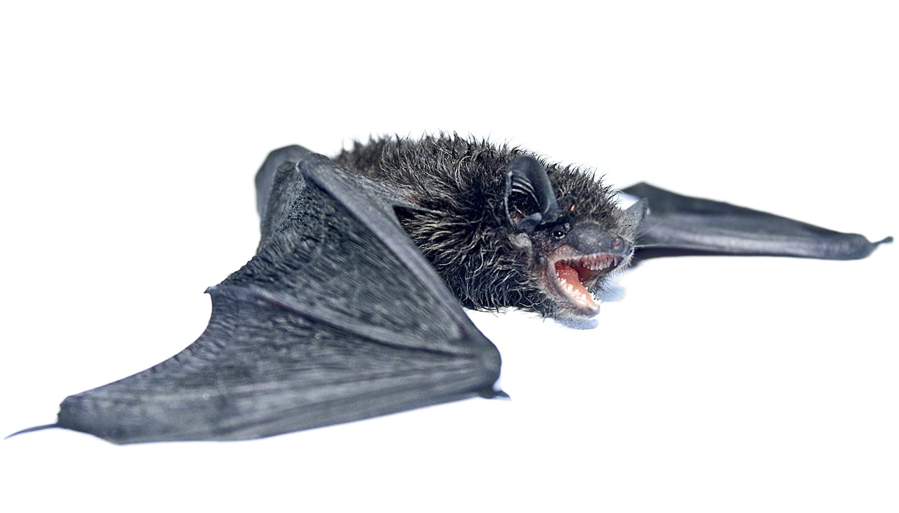

# 蝙蝠免疫之谜获新解：竟有两套抗体重链基因

> 为什么蝙蝠能携带多种烈性病毒却很少重病？杜兰大学与斯坦福、CDC合作的研究在《Science Advances》给出新线索：夜蝠科蝙蝠拥有两套独立的抗体重链基因系统，而其他哺乳动物只有一套。

这一发现改写了“哺乳动物免疫系统如何组织”的认知。

## 别的哺乳动物一套，夜蝠有两套

抗体是Y形的蛋白，由两条重链和两条轻链组成。此前已知的所有哺乳动物，重链都由单一基因簇编码。研究团队在夜蝠科（Vesper bats，全球约500多种，除南极外各大洲均有分布）中发现了两套完全独立的重链基因系统，能以全新方式生成抗体多样性。

通讯作者、杜兰大学生态与演化生物学副教授Hannah Frank说：“我们在哺乳动物里从未见过这样的结构，这彻底改变了我们对免疫系统组织方式的理解。”

## 为何盯上适应性免疫

过去对蝙蝠免疫的研究多聚焦于先天免疫，而这项工作把聚光灯打向适应性免疫——即产生抗体的那一支。Frank认为，这套“双重链”系统或许是夜蝠演化成功的部分解释，也为“为何蝙蝠能与病毒共存”提供了新方向。

她同时强调，这不是全部答案：“我们认为这是拼图的重要一块，但不能单凭它解释蝙蝠为何是高效的病毒库；它揭示了一种前所未见的免疫多样性，给了我们全新的探索路径。”

## 意义不止于蝙蝠

蝙蝠是重要的传粉者、种子传播者和天然控虫者，同时也是多种病毒的自然宿主。搞清它们如何在不发病的前提下与病毒共存，有助于理解跨物种的免疫差异，并为预防病毒溢出提供思路。

Frank说：“我们对免疫的很多认知来自人和实验小鼠，但自然界远比这丰富。每研究一个在演化上走出不同路径的物种，都可能补上认知空白。”
