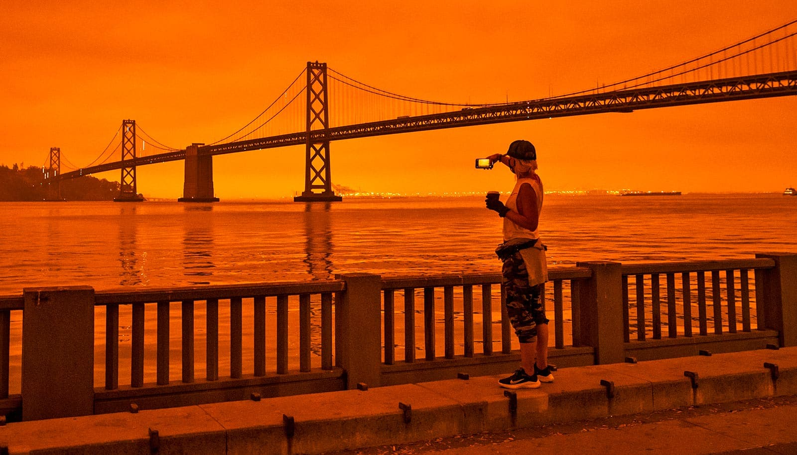

# 野火烟雾影响经济的三种方式：花钱少了、效率低了、医疗贵了

> 佐治亚理工经济学家Casey Wichman提醒：野火即使远在数百英里外，烟雾仍会通过空气污染改变消费、拖累效率、推高医疗成本。

当AQI从健康的0-50飙到500以上，经济账本也在跟着冒烟。

## 背景：清洁空气的成果被烟雾蚕食

过去40年，《清洁空气法》等法规显著改善了美国空气质量。但随着更热更干燥的气候让野火规模变大、火季拉长，烟雾正抵消这些进展。已有研究估算，野火烟雾已抹掉约四分之一的改善幅度，在西部多州甚至超过一半。

“野火季正在成为新常态。”Wichman说。他任职于佐治亚理工经济学院，也是CLEAR气候·环境·资源经济实验室成员。

## 方式一：少花钱，本地消费下滑

重污染日，人们更倾向待在室内，逛街、餐饮、户外消费随之减少，依赖客流的商户首当其冲，音乐节、赛事等户外活动也可能取消。烟雾把“出门花钱”变成了“在家观望”，本地经济循环被按下慢放键。

## 方式二：效率打折，连室内也难幸免

污染会削弱专注力和决策能力。Wichman提到，即使短时暴露也会降低生产率——例如空气污染加重时，棒球裁判的误判率会上升。居家或办公室并非完全隔绝，室外污染仍会渗入室内，拖累工作效率；在农业、建筑等户外行业，员工可能主动请假或企业基于安全停工，劳动参与率随AQI波动。

## 方式三：医疗账单变厚

烟雾与呼吸道、心血管等健康风险相关，进而推高医疗支出。Wichman强调，评估气候变化的真实成本时，必须把“烟雾—污染—健康—支出”这条链条算进去，否则会系统性低估损失。

目前学界对野火社会成本的核算仍在完善中，但已明确的是：烟雾的经济影响远不止“呛鼻子”那么简单。
