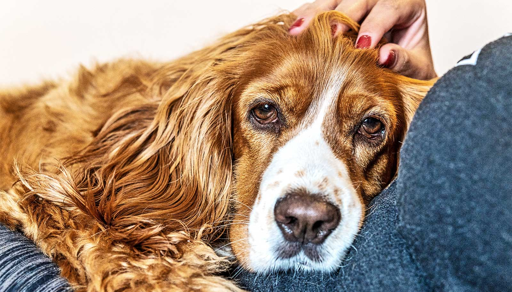

# 狗猫也会得痴呆：夜里睡不好、互动变少，是认知衰退的信号

> 狗猫老了，夜里睡不好、和主人互动变少、时常困惑焦虑——这些常被当成“正常衰老”的表现，可能是痴呆的信号。德州A&M大学兽医专家介绍：狗最早8岁就可能出现认知功能障碍，18岁以上的狗约八成受影响；猫10岁左右起病，15岁以上超半数表现出相关迹象。

别把毛孩子的行为变化都归咎于“老了”，狗猫同样会得认知功能障碍

## 不只是“变老了”：狗猫也会得痴呆

狗猫上了年纪，夜里睡不好、不再缠着主人、有时显得困惑又焦虑……这些变化太容易被一句“老了”带过，但兽医提醒：它们可能是痴呆的表现。

和人类一样，狗猫随年龄增长也可能发展出痴呆。兽医称之为认知功能障碍——大脑发生的变化，会影响宠物如何思考、学习和记忆，进而改变行为。麻烦在于，这些行为变化很容易被误当成别的病，甚至被当作衰老的正常现象一笔带过。

德州A&M大学兽医学院与生物医学科学学院临床助理教授Joel White，为想读懂宠物行为变化的主人给出了一份指南。

## 狗8岁、猫10岁，认知障碍就可能找上门

狗的认知功能障碍最早8岁就可能出现，这个年纪的狗约有10%已经受影响。White说：“患病率随年龄稳步上升，18岁以上的狗约有80%受累。”

猫的症状通常10岁左右开始显现，患病率同样随年龄增长——15岁以上的猫，超过半数表现出与痴呆一致的迹象。

White解释，现在这类问题之所以更常见、也更容易被看见：“随着兽医医学进步，许多狗猫活得比以前更久，患上这种病的可能性也随之增加。与此同时，兽医和主人对这种病越来越了解，也更善于识别和诊断它。”

## 夜里不睡、互动变少、犯糊涂，都值得留心

认知衰退的早期信号，往往就藏在日常里：夜里难以安睡，与主人的互动明显减少，行为上出现困惑或焦虑。

但这些变化和其他疾病高度重叠，很容易认错。White举例：“爬楼梯变得困难，看起来像关节炎；在家里随地大小便，则可能是尿路感染或肾病的信号。”

猫还有一些自己的“花样”：它们会过度舔毛，直到舔出秃斑。White说，猫极擅长在主人和兽医面前藏病，这让它们更难被确诊。老年猫还常伴随其他疾病，尤其是甲状腺机能亢进——甲状腺激素分泌过多引起的甲亢，同样会带来类似痴呆的行为与活动改变，让准确诊断变得更加重要。

## 医生怎么判断：问主人，再排除其他病

怀疑痴呆时，兽医会借助基于主人观察的问卷来评估——宠物表现出的迹象越多，认知功能障碍参与其中的可能性越大。“一份详尽的生活史，是诊断宠物痴呆最有价值的工具。”White说。

此外，验血配合体格与神经系统检查，可以排除其他症状相似的疾病。最确凿的手段是核磁共振成像（MRI）——能直接观察痴呆相关的大脑改变，但它需要麻醉，费用也不便宜。

## 没有治愈之法，却能让它舒服些

狗猫的痴呆目前无法治愈，但调整日常作息和环境，能缓解症状、保住生活质量。

规律的运动很重要：狗可以牵绳散步、玩接球，猫可以玩食物迷宫和互动玩具，让它们身体动起来、脑子有活干。White提醒，当宠物还患有严重关节炎等疾病时，运动并不容易：“许多主人会想出有创意的替代方案——大一点的宠物可以游泳，小一点的可以在浴盆里轻柔活动，或坐进推车、航空箱、宠物背包里到户外透透气。”

固定的陪伴与规律的相处，同样能支撑宠物的状态。对症状较重的宠物，安全、可预期的环境尤为关键，因为突然的变化会带来压力：主人可以封住宠物可能受伤的区域，给尖锐的家具角包上护垫，并避免大改动，比如重新摆家具或搬家。

饮食也能帮上忙：富含中链甘油三酯（MCT）和维生素E、omega-3等抗氧化物的食物，可能改善临床迹象。市面上已有针对狗的这类配方粮，猫的版本还没有；哪些补充剂合适，也该由兽医把关。当生活方式和饮食都管不住时，药物可以作为选项——但宠物对药物反应各异，务必在兽医指导下使用。

## 它不是在捣乱，只是病了

对许多主人来说，最难的是看着病情进展还要保持耐心。深夜里被吵醒、地毯上又留下“意外”，烦躁在所难免。White说：“尤其当这些事反复发生时，人们很容易忘记，宠物并不是故意找麻烦——比如半夜把你叫醒、在地毯上大小便。这种时刻，不妨停下来，深吸一口气，提醒自己：它病了，不是存心不听话。”

痴呆会改变与老龄宠物相处的许多细节，但耐心、怜爱与高质量的陪伴，仍能让人把相伴的岁月过得有滋有味——它或许记不清昨天，却依然认得你的气味和声音。
