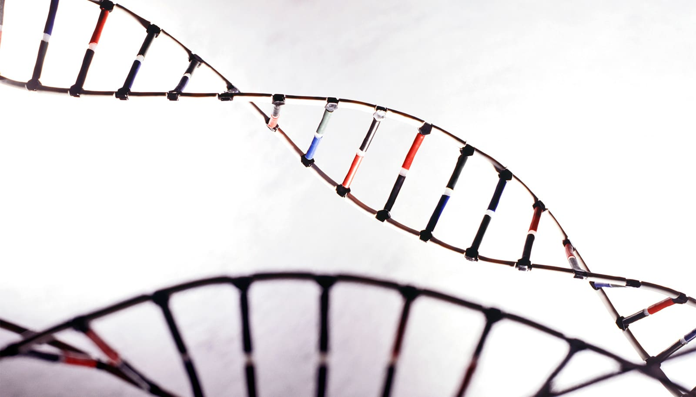

# 人类基因组暗藏一层全新结构

> 佐治亚理工学院团队首次绘出嵌入人类DNA的核糖核苷酸全基因组图谱，发现这些曾被当成“必须清除的错误”的小分子，并非随机分布，而在活跃基因起点附近格外密集，还能改变DNA的扭曲缠绕方式——这项发表于《Cell》的发现，可能改写人类对DNA组织、转录和基因组学的认识。

曾被视作错误的RNA小分子，在人类基因组中暗藏一处全新的结构层

## 不是错误的“错误分子”

在细胞里，DNA和RNA通常是两种各自分工的独立分子。但一些小小的RNA组成单元——核糖核苷酸——有时会在细胞的日常活动中嵌入DNA。科学家早就知道这些RNA组成单元存在，但此前既不知道它们分布在整个人类基因组中的位置，也不清楚它们是否有作用。

Storici团队与多家机构合作，绘制出这些RNA组成单元在人类DNA中的精细地图。结果发现，它们并非随机散落，而是在基因组中以清晰可辨的规律分布。研究者把这种DNA嵌入核糖核苷酸的全基因组景观，称作人类细胞核内的“核糖体组”（ribome）。

佐治亚理工学院生物科学学院教授、Parker H. Petit生物工程与生物科学研究所成员Francesca Storici说：“嵌入DNA的核糖核苷酸，传统上主要被视为需要清除的错误。我们的发现提出了另一种视角：它们能影响DNA的物理特性，并可能具有我们才刚开始理解的生物学功能。”

## 藏在基因组里的一层“调节开关”

团队发现，这些嵌入的RNA组成单元在活跃基因的起点附近格外常见——那是细胞开始读取遗传指令、制造RNA的地方，其数量也随基因活性增加而上升。这些区域承受着物理应力，因为DNA在那里被反复存取和使用。

研究证据显示，嵌入的RNA组成单元会影响这些区域中DNA扭转、盘绕的紧密程度。这种DNA扭转被称为“超螺旋”，与转录密切相关。

这些发现表明，RNA组成单元不只是细胞正常过程的偶然残留，而是能够调控DNA超螺旋——揭示出嵌入核糖核苷酸、DNA拓扑结构与转录之间此前未被认识的联系。

Storici说：“最令人兴奋的发现之一是，加工嵌入DNA的核糖核苷酸可以改变DNA超螺旋。这在DNA的化学组成、它的物理组织和转录之间，建立了一条新的联系。”

## 从“错误”到基因组的一部分

这项工作可能帮助科学家更好地理解与清除嵌入RNA缺陷相关的疾病，包括罕见的自身免疫性疾病。更广泛地说，这一发现可能为研究嵌入核糖核苷酸在人类基因组生物学中的作用开辟全新领域。

通过提供人类细胞核DNA中这些RNA标记的第一张全面图谱，研究说明：那些曾被当成简单分子错误的物质，可能实际上参与着基因组的组织和运作。这一发现为探索嵌入核糖核苷酸如何影响DNA拓扑、转录和基因组维持，打开了新的可能性。研究由佐治亚理工发布。