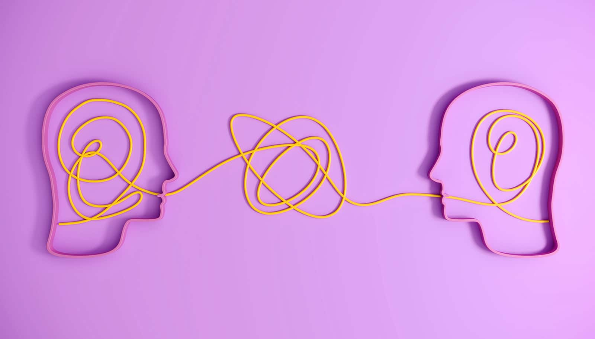

# 陌生人一起作画、逐渐成为朋友时，大脑活动如何变化

> ETH苏黎世团队让61对互不相识的年轻人和老年人合作作画整整六周，用可穿戴脑传感器持续记录——结果出乎意料：跨代际的搭档开头大脑更容易同步，之后却一周比一周低；同龄搭档刚好相反。研究者发现，大脑越来越同步，未必代表两人越来越亲近。

合作作画六周，陌生人的大脑活动如何一点点靠近又疏远

## 一起画画，把陌生处成朋友

当两个人一起从事创造性的共同活动、又在过程中建立起新的关系时，大脑里发生了什么？这一问题始终吸引着ETH苏黎世认知科学家Ryssa Moffat。她是社会脑科学实验室的博士后研究员，研究发表于《PLOS Biology》。

实验设定是这样的：连续六周，61对参与者每周见面一次，一起画画。参与者分属两个年龄段——18到35岁的年轻人，和70到85岁的老年人，被分成31对跨代际搭档和30对同龄搭档。

起初，这些参与者互不相识，得先慢慢熟悉起来。每次见面，搭档们先在各自纸上独立作画，再在同一张纸上合作画两次；可以轮流画，也可以同时画。全程可以交谈，但作画时必须保持安静。

## 脑电波会同步，但方向出人意料

每次会面，研究者用可穿戴脑传感器记录大脑活动，从而观察“从陌生到熟悉”如何反映在两人的脑活动上。可穿戴设备的优势在于，参与者可以像日常一样自由行动、回应对方，不影响信号。

研究者最关心的是大脑活动的相似性：两人相遇时，大脑在多大程度上“同步”？这种同步在一次次会面中如何演变？他们关注的核心是所谓的“大脑间同步”——共同作画时，每个人的大脑会不断回应对方的动作，当两人脑活动中出现相似变化时，大脑就可视为“同步”。

以往关于大脑间同步的研究提示：随着两人越来越熟悉，两套脑活动模式应越来越相似。Moffat团队最初也预期，随着搭档磨合，同步会随时间增强——但结果令他们惊讶：跨代际搭档尽管在几周里感觉彼此更亲近，脑活动模式却没有越来越相似。

Moffat说：“跨代际搭档的脑同步一开始更高，然后一周周下降。”而“同龄搭档正好相反：从较低的同步起步，在六周里不断升高。”

无论趋势如何，有一点是明确的：两人一起画时，脑同步总比各自独立画时更高。也就是说，合作本身就能带来更高的大脑同步——起初两组表现相似，只是随着六周推移，同龄搭档的脑活动越来越像，跨代际搭档则趋于下降。

## 大脑越来越同步，未必代表更亲近

为何会有这种差异？目前还没有确切的答案。借助可穿戴扫描技术，Moffat至少可以确定一点：两人感觉更亲近，并不必然意味着大脑“同步共振”。

这项研究采取的角度，与许多早期大脑同步研究不同。以前的研究假设，共同经历的人会处理相似的刺激，大脑因此做出一致反应——这被称为“共同认知加工”模型。Moffat的解释则不同：她认为两人会学会更好地预判对方的行为并加以适应——对方接下来会说什么？我的建议他会如何反应？这一方向在学界被称为“相互预测”模型。

这个模型或许能解释研究中出现的年龄差异。Moffat指出，生活经验也会影响相互预测：“同龄参与者大多是作息相近的学生，很快就能找到共同话题；而年轻人和老年人，得先琢磨彼此到底能聊什么。”

对她而言，这意味着：更高的大脑同步，也可能意味着两人正在格外努力地理解对方——这种努力尤其在一段关系开始时最需要。第一次见面时，年轻人和老年人更难预判对方的行为；同龄人往往更快找到共同点、甚至早就有默契，但随着时间推移，同龄人会变得更放松、在交谈中不断给对方惊喜，反而让对方更难以预测。

## 六周里，大脑还有七个“双脑状态”

在另一项发表于《Acta Psychologica》的研究中，团队从另一个角度审视了同样的会面和测量数据：他们考察了会面中反复出现的共享脑活动模式，识别出七个贯穿六周都相当稳定的所谓“双脑状态”。

其中一个状态很特别，在跨代际搭档中持续的时间明显长于同龄搭档：这种状态下，两脑之间的同步相对较低，突出的反而是单个人大脑内部、自己额叶两个区域之间的“内同步更强”。研究者谨慎地把它解读为一种角色分工的信号：内同步较强的人更倾向于适应对方的行为——大多数情况下是年轻人，而老年人往往扮演领导角色。他们还发现，同龄搭档更常同时作画，跨代际搭档则更多轮流来。

Moffat总结：“我们的研究首次在一个多周的时间尺度上展示，年轻人和老年人脑活动是如何演变的。”过往研究多聚焦亲子、师生、医患和伴侣关系，老年人长期被社会脑研究忽视。

从长远看，Moffat的工作或许也能揭示“陌生人如何变成熟人、甚至朋友”。研究由ETH苏黎世发布。