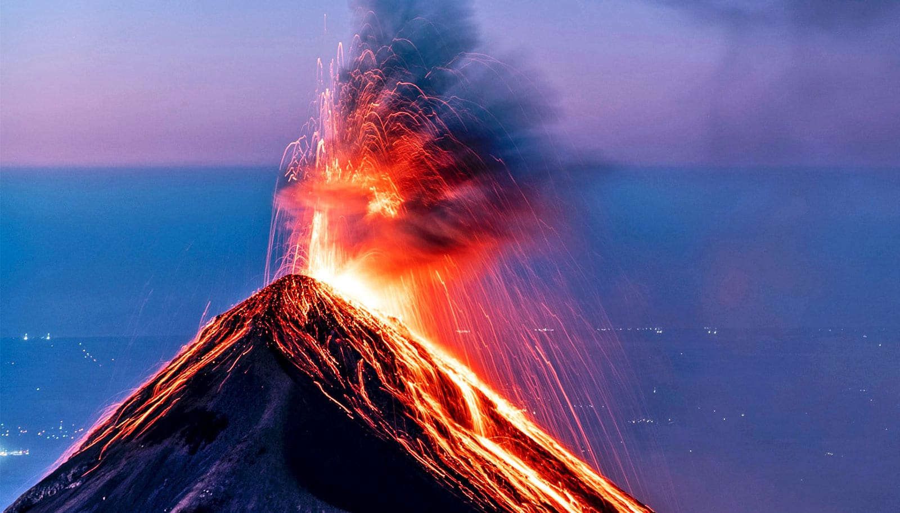

# 播客聊聊人们对火山的常见误解

> 北卡州立大学火山学家 Arianna Soldati 在新一期播客里，拆解大众对火山和火山喷发的几个最常见误解：熔岩流到底能不能引开、黄石公园真实情况如何、教科书标注地幔该用什么颜色。

火山学家 Arianna Soldati 做客播客，专门聊那些被影视剧和传言反复放大的火山印象。

## 三个逃不开的老问题

这一期没有绕开任何热门话题，直接回应了三种常见的追问。有人说能开渠改道、让熔岩绕过村子绕流而去——引开熔岩流听起来很美，真相往往和想象有距离；黄石公园是被念叨最多的超大型火山聚集地，它的实际状态常被各种说法夸大或歪曲。至于教科书该用哪种颜色标地幔，看似吹毛求疵，背后却是教材画法如何在塑造我们对地底的想象。

## 一段通俗的科普预告

这期节目是典型的口语化科普，篇幅不长，目的是把严肃的专业话题讲给普通听众。关于这三个问题的完整讨论和逐字稿，可以到 Futurity 原文页面收听。

来源：北卡州立大学（North Carolina State University）