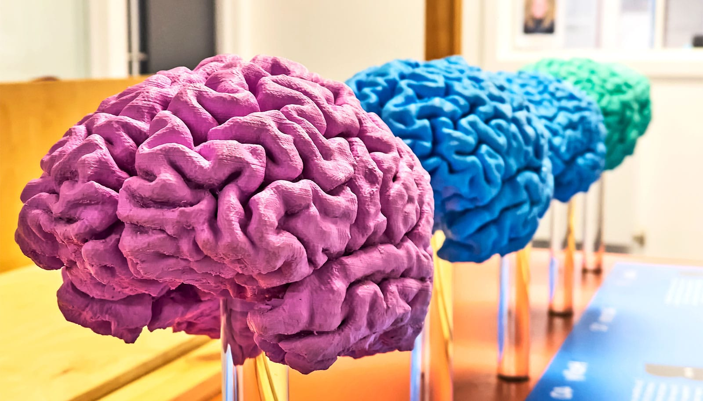

# 氯胺酮如何重塑老年人脑活动

> 德克萨斯A&M大学研究团队首次发现，老年难治性抑郁症患者在注射氯胺酮后，脑活动的组织方式会随时间呈现不同模式：治疗1小时、24小时和7天各有变化，其中24小时脑内信息共享的增加，与第7天抑郁症状的改善相关。这一发现发表于《Translational Psychiatry》，为识别氯胺酮抗抑郁效应的生物学标记、理解患者为何应答各异，提供了新线索。

氯胺酮治疗老年抑郁症后，大脑信息组织随时间不断重塑

## 老年难治性抑郁症：氯胺酮少有人用

氯胺酮正越来越多地被用作难治性抑郁症的快速起效治疗。然而，这一疗法在老年人中并未被广泛采用——担忧主要来自与衰老病理相关的安全性和疗效问题。

为回应这些疑问，德克萨斯A&M大学情绪与焦虑障碍实验精神药理学实验室（EPMAD Lab），由精神病学系主任、教授Sanjay Mathew领导，一直在研究55岁以上美国退伍军人的大脑如何对氯胺酮作出反应。

论文发表在《Translational Psychiatry》。研究者希望能借此识别与氯胺酮抗抑郁效应有关的潜在生物学标记，并更好地理解为什么不同患者对治疗的反应不一样。

## 开闸放水：谈的是流动，不是冲击

EPMAD Lab神经科学导向治疗方向的协调人、精神病学与行为科学系研究副教授Nicholas Murphy，把氯胺酮的作用比作打开闸门：药物让信息得以在大脑中流动，从而增强神经系统的灵活性。他提出，患者对氯胺酮的临床应答，与大脑的可塑性关系更密切，而不是最初的应激反应有多剧烈。

“打个比方，假设你在沙漠里有一张河流分布图，”他说，“你打开水坝，现在所有支流都被水淹没了。于是这些地方之间有了连接——这正是氯胺酮所做的：它帮助营造一个更灵活、连接更密集的环境。但这还不是故事的终点。”

Murphy补充说：“要让这些有用，我们需要弄清楚水是如何流动的——这正是我们当前分析所做的事。它告诉我们氯胺酮释放的谷氨酸‘涌流’，需要如何流动才能带来临床改善。”

## 一次输注，脑内信息如何随小时与天在变

这项新研究聚焦于接下来的问题：老年人在使用氯胺酮之后，信息在大脑中是如何组织的，这种组织又如何在时间推移中改变。

德克萨斯A&M大学团队与贝勒医学院（Baylor College of Medicine）、巴利阿里群岛大学（University of the Balearic Islands）的研究者合作，考察了单次氯胺酮输注后数小时至数天内的大脑活动。

精神病学与行为科学系研究助理Krisha Shah说，团队的目标是弄清氯胺酮如何随时间推移重塑大脑内部的信息交流，以及这些变化如何影响患者的临床应答。

“通常，EEG研究只关注单个脑信号，或是成对信号之间的通信，但大脑并非成对运作的，”她说，“它是一个高度互联的系统。”

“氯胺酮特别之处在于，药物暴露时间很短暂，但抗抑郁效应却能远远延续到这段体验之后。”

## 高阶相互作用：不只盯单个或成对信号

为捕捉这种复杂性，研究者采用了“高阶相互作用”（high-order interactions）——一种信息论方法，能同时考察信息如何在多个EEG信号之间组织，而非仅仅单独或成对地观察。

研究结果发现，氯胺酮并没有产生单一、稳定不变的脑活动模式。相反，信息组织会随时间显著变化，在治疗后1小时、24小时和7天分别呈现出不同模式。其中，24小时时脑内信息共享某一指标的增幅越大，第7天抑郁症状的改善越明显。

## 更灵活的大脑，胜过更大的初期反应

这项研究建立在团队此前两篇论文的基础上——此前工作表明，静脉注射氯胺酮在老年人中既可行又有效。通过绘出氯胺酮输注后的大脑连接随时间变化的图谱，研究者识别了一些可能作为氯胺酮在老龄人群中抗抑郁效应潜在标记的脑信号变化。新研究还重复并扩展了此前在健康志愿者中进行的高阶相互作用研究。

Murphy指出，老年群体在临床上长期被忽视：“大多数药物研究的受试者到65岁就截止了，关于氯胺酮如何影响衰老大脑的研究少之又少。”

“尽管老年人占全美人口的三分之一以上，他们在临床研究中仍然代表性不足。”

谈及氯胺酮本身的属性，Murphy说：“氯胺酮从一开始只是麻醉剂，走到今天已经走了很远。不过它依然具有较强的滥用潜力。我团队做这项工作的目标，就是找出这条生理路线图上的关键节点，以便未来能通过另一种、不具备氯胺酮那种致幻作用或医学副作用的机制，在这些节点上施加干预。”研究由德克萨斯A&M大学发布。