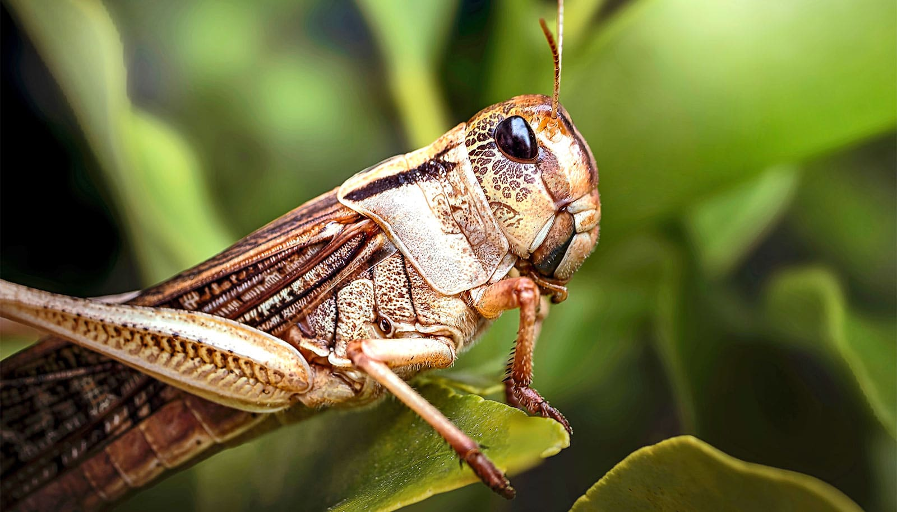

# 蝗虫大脑或能检测全氟污染

> 密歇根州立大学团队发现，蝗虫大脑中负责处理气味的神经元，能在环境相关浓度下区分包括PFOS在内的多种全氟化合物，每样化学品都会留下独特的神经活动“气味指纹”——这或可催生更快、更便宜的全氟污染现场检测手段。

蝗虫靠嗅觉辨认世界的本领，或能反过来帮人类“闻”出污染水里的全氟化合物

## 一种实验室很难对付的“永久化学品”

不粘锅、防水织物、灭火泡沫……全氟和多氟烷基物质（PFAS）藏在大量日常用品里。它们的问题是降解极慢，一旦进入水源、土壤和生物体内就长期停留，既不好追踪，也不易清理。

“PFAS极难检测，”论文通讯作者、密歇根州立大学工程学院与定量健康科学与工程研究所副教授Debajit Saha说，“我们迫切需要能在极低浓度下识别它们的技术。”

## 传感器拼不过生物，那试试用生物本身

几十年工程化尝试下来，科学家始终很难做出在灵敏度上匹敌活体的化学传感器——很多化学物质至今要靠狗来当“探测器”，昆虫则高度依赖嗅觉在环境中辨认方向。Saha团队索性绕开人造传感器，直接问：昆虫自己能不能区分不同的全氟化合物？

研究者记录下蝗虫大脑处理气味区域的神经活动，让虫体接触包含PFOS等多种全氟化合物的气体。测验结果本身就让团队意外。

“我们一开始都不确定蝗虫大脑会不会对PFAS有任何反应，”论文第一作者、Saha实验室博士生Summer McLane-Svoboda说，“一旦看到不同化合物对应着明显不同的神经活动模式，我们就意识到：生物学或许能成为一个强大的PFAS传感平台。”

## 每样化学品，都留下自己的“气味指纹”

实验确认，每种PFAS都会在大脑中唤起一种特有的神经放电模式，相当于专属“气味指纹”，让蝗虫能把不同化学品区分开。团队还演示了蝗虫能察觉接近受污染环境样本浓度的PFOS。

这个结果让研究者困惑：PFAS是纯人工物质，只存在了几十年，蝗虫的嗅觉得以进化的时间里根本没有这种物质，它的感觉系统为何反应如此强烈？

“我们很惊讶蝗虫大脑对PFAS反应这么强，”Saha说，“出于某种原因，这套感觉系统能检测这些自然界并不存在的人工化学品。”

## 精密仪器难进现场，检测之痛在此

眼下检测PFAS通常依赖液相色谱-质谱联用（LC-MS）这类实验室仪器：精度高，但价格昂贵、需要专门设施，很难搬到现场；加上不少方法只针对某几种特定化合物，要做大范围污染筛查并不轻松。这正是“活体传感器”想补上的缺口。

## 下一步：把“嗅探”带出实验室

这项研究目前只算概念验证。团队下一步计划测试在密歇根采集的环境水样，看看这招在实验室之外能否照常识别污染；更长远的目标，是把技术缩小成便携式生物传感器，在现场快速筛查多种PFAS。

“生物学可能提供一种完全不同的PFAS检测思路，”Saha说，“既然活体感觉系统认得这些化学品，我们或许能做出更快、更多用途的污染监测工具。”研究发表在期刊《Journal of Hazardous Materials Advances》上。