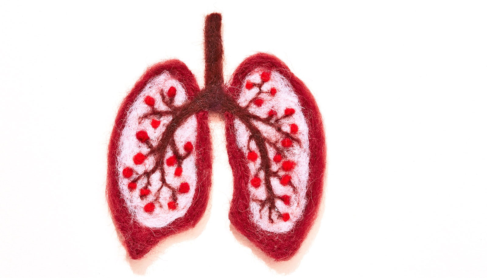

# 新型蛋白基MRI造影剂可更早检测侵袭性肺癌

> 佐治亚州立大学研究团队开发出蛋白基MRI造影剂，能在肺癌扩散前检测到1毫米大小的肿瘤和转移灶，且不使用有害辐射。

蛋白基MRI造影剂hProCA32.Collagen靶向肿瘤微环境中的I型胶原蛋白，可在肺癌早期实现全身精准成像。

## 1毫米肿瘤也能看见

肺癌往往在扩散后才被发现，那时治疗选择已经很有限。佐治亚州立大学名誉教授杨晶·J·杨（Jenny J. Yang）团队开发的一种新型蛋白基MRI造影剂，能够在更早阶段捕捉到肿瘤及其转移灶。这项成果发表在《科学进展》（Science Advances）上，报告称新方法最薄微的检测限度可达1毫米。

传统影像手段要么分辨率不足，要么依赖辐射（如CT、PET）。这款名为hProCA32.Collagen的造影剂不一样——它专门靶向I型胶原蛋白。这种结构蛋白在侵袭性肺瘤和转移病灶中含量偏高，相当于为癌症微环境竖起了一面可成像的旗子。研究人员在动物模型中借此不仅定位了肺部小肿瘤，还检出了到肾上腺、肾脏等器官的转移，并绘制了与肿瘤侵袭和进展相关的生物学特征图谱。

## 不仅看得早，还能看出"性子"

这项技术的另一个亮点是，它不只回答"有没有癌"，还能透露一些癌症有多侵袭性的信息。杨团队此前开发过靶向癌症生物标志物CXCR4的成像剂，如今的hProCA32.Collagen同样沿用了生物标志物导向的分子影像思路——锁定肿瘤微环境里异常沉积的胶原蛋白，从而在癌症发展的更早阶段增强成像对比。这种针对肿瘤环境而非单纯解剖结构的策略，代表了分子影像技术的一个新方向。

研究发现，该方法对某些突变相关的侵袭性肺腺癌尤其管用。这类癌症往往对现有疗法阻力较大，也更容易往多个器官扩散。如果成像能在它们站稳脚跟之前就给出预警，临床决策的主动权就多了——有可能减少对侵入性穿刺活检的依赖，也能更早判断癌症的侵袭潜势。

## 谁把这事做成了

这是一次多校合作的结果。佐治亚州立大学的杨团队牵头了胶原靶向造影剂和精准MRI方法学的开发，共同第一作者李东军·达伦（Dongjun Darren Li）和奥卢瓦布科拉·索菲亚·巴米谢耶（Oluwabukola Sophia Bamishaye）来自该校的诊断与治疗中心及疾病分子基础项目。成像实验在佐治亚州立大学先进转化成像设施（ATIF）完成。

埃默里大学温斯 RNA癌症研究所的周伟（Wei Zhou，共同通讯作者）提供了癌症模型和癌生物学、转化研究方面的专业知识。阿拉巴马大学伯明翰分校（UAB）的合作者则贡献了成像物理和图像分析的专业力量。研究由杨和周共同领导。

资金方面，研究部分由美国国立卫生研究院（NIH）支持。文中提及的技术正由杨创办的生物技术公司InLighta Biosciences向临床推进——该公司已从佐治亚州立大学获得相关知识产权许可，并在NIH的中小企业创新研究（SBIR）和中小企业技术转移（STTR）资助下，致力于推动下一代蛋白基诊断和治疗试剂走向临床开发。团队目前正在向美国食品药品监督管理局（FDA）递进申请，目标是启动临床试验。

## 远不止诊断

这项影像技术的意义不止于"早一点看见癌症"。通过让医生在原发灶和转移灶中都看见胶原重塑的过程，它有望帮助识别高风险患者、指导治疗方案的选择，并随时间监测治疗反应。换句话说，从一次更早、更安全的扫描里，既能少受罪，又能多些决策依据。

杨说，这是一场癌症诊断和精准医学领域的游戏规则改变。他们首次证明，精准MRI能在不使用有害辐射的同时，检测出微小肿瘤和全身转移，并提供癌症行为是否激进的重要线索——那正是临床上最需要的早和准。
