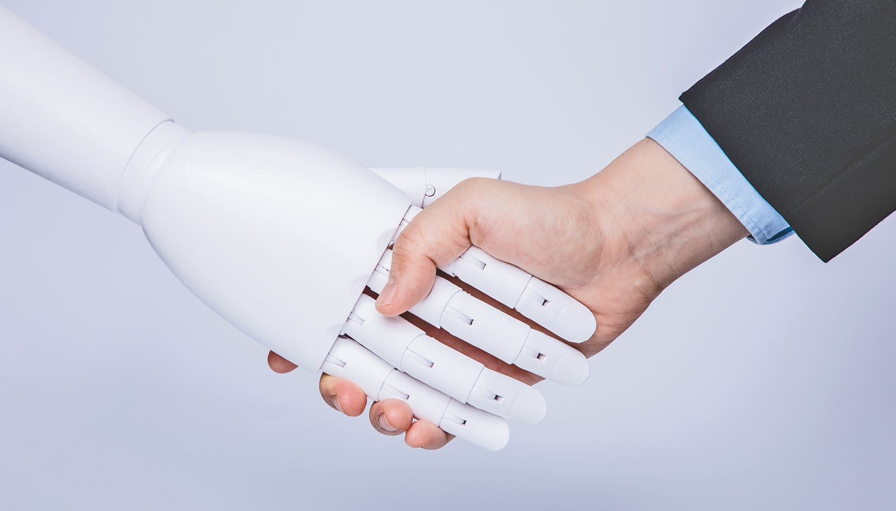

# AI 面试如何影响求职者行为

> 使用 AI 进行初轮面试确实能节省时间和成本，但它也会改变求职者的行为——而且并不总是向好的方向：当求职者知道自己的视频会由 AI 评估时，他们会更多地夸大和虚假陈述，而 AI 评分系统却无法分辨。

佐治亚大学研究揭示 AI 面试对求职者行为的影响。

## AI 面试为何让求职者不安

佐治亚大学（University of Georgia）的新研究发现，使用 AI 进行初轮面试确实能节省时间和成本，但它也会改变求职者的行为——而且并不总是向好的方向。

研究员 Akshat Lakhiwal 及其团队发现，当求职者知道自己的视频会由 AI 而非人类评估时，他们往往会在单项异步视频面试中过度补偿紧张情绪，表现出更多的夸大和虚假陈述。而当前的 AI 评分系统无法分辨求职者是否在夸大其词。

"如果你在申请梦想公司的职位，而梦想公司想用 AI 来面试你，你真的没有多少选择，"Lakhiwal 说，"你真的不想说不，但你也不知道它是怎么工作的。"

## 单项异步视频面试的兴起

单项异步视频面试是一种求职者对着摄像头录制回答标准问题（如"为什么应该雇用你？"或"介绍一下你自己"）的面试形式。这种形式最早推出时，确实让初轮面试的安排变得更容易，排序功能也让招聘人员能方便地比较多位候选人对同一问题的回答。

如今，越来越多的公司允许 AI 系统对候选人的回答进行评分和排序，以节省时间。这一变化让求职者感到"有些无所适从和无助"。

## 夸大行为显著增加

Lakhiwal 对数百位在线求职者进行的研究显示，当候选人知道自己的视频将由 AI 代理（而非人类）评估时，自我报告的"夸大"或"欺骗性美化"显著增加。对其视频和回答的分析也证实了这一点。

当被问及夸大资质是否合乎道德时，参与者表示，在不可预测的环境中表现出色这是"必要的"。

"很多夸大行为确实发生了，"Lakhiwal 说，"他们似乎在往火里扔东西（throwing the kitchen sink），试图给评估者它想找的东西。"

## AI 评估者无法识别夸大

研究中使用的、行业青睐的 AI 代理并没有惩罚那些夸大事实的求职者——它给他们的评分与那些诚实描述拥有同样资质的求职者一样好。

相比之下，当人类评估者观看这些视频时，他们似乎能够辨别这种行为。人类评估者普遍对那些候选人进行了扣分，并将最高评分给予那些表现出更真实行为的候选人。

## 解决之道：透明度

Lakhiwal 的团队发现，一种遏制求职者对 AI 评估者夸大的倾向的方法是解释面试过程。

在一项实验中，一组受访者被告知其视频将由 AI 审核，然后获得了关于 AI 具体关注内容的详细信息。他们被告知，系统会关注面部表情、语言情感和特定关键词，并根据团队合作、与工作相关的能力、工作方式和个性对视频进行评分。

结果显示，这一组报告并表现出的真实行为量，与那些被告知将由人类审核的受访者相同。

"传统上，公司在招聘过程中避免透明度，"Lakhiwal 表示，"他们不喜欢这个词，因为他们觉得如果参与者知道如何被评估，求职者可能会操纵系统。确实有研究表明了这一点。但是我们这里发现，告诉求职者更多关于流程的信息，让他们能够更加真实。"

Lakhiwal 倡导透明度，但重点在于求职者理解流程的能力，而非具体的技术细节："我并不真的需要知道他们用哪个模型来分析我的视频，但作为候选人，重要的是能够像理解人工面试那样，理解这个流程的意义。"

## 启示

了解人类如何与工作场所中的自动化系统互动并做出反应，对于防止这类技术在组织中产生反效果至关重要。

这项研究发表在《Information Systems Research》期刊上。共同作者包括 Che-Wei Liu（亚利桑那州立大学）、Hillol Bala（印第安纳大学）和 Hung-Yue Suen（国立台湾师范大学）。

