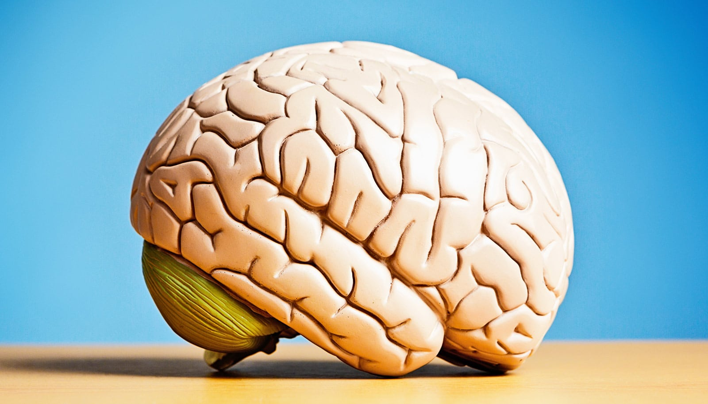

# 大脑机器接口如何帮助瘫痪患者

> 如果你的思想可以让你感受到物体的纹理、打出一条消息、或移动一台机械臂——芝加哥大学神经科学家正在将这一设想变为瘫痪患者和 ALS 患者的现实。

植入大脑的微电极阵列正在解码瘫痪患者的神经信号，让他们通过意念控制机械肢体并恢复触感。

## 思想如何变成动作

我们的大脑如何将一个简单的念头——比如"伸手拿杯子"——转化为实际的物理运动？对健康人来说，这是自动完成的生理过程：神经信号从大脑出发，沿着脊髓下行，驱动肌肉收缩。但对瘫痪患者而言，这条通路 somewhere 被切断了。大脑仍在发出指令，身体却收不到。

芝加哥大学神经科学家 Nicholas Hatsopoulos 正在攻克的，正是这个根本性的神经科学难题。他把基础研究转化为改变生命的医疗技术：通过在大脑中直接植入微电极阵列，他的团队能够解码当一个人"意图移动"时激发的神经模式。

## 意念控制与复康触感

这套脑机接口技术正在为瘫痪患者和渐冻症（ALS）患者打开新的可能性。患者不再需要完整的神经通路——设备直接读取大脑的意图信号，译码后驱动外部设备。临床应用包括：控制机械臂完成抓取动作、通过意念操作界面打字、以及最令人瞩目的——通过 thoughts 恢复触觉体验。

对一个失去肢体感觉的患者来说，重新"感受到"物体的纹理不仅是功能上的恢复，更是重建与世界物理联系的体验。这也是 Hatsopoulos 研究的核心愿景之一：不只是让瘫痪患者动起来，更让他们重新感知。

## Big Brains 播客访谈

Hatsopoulos 在芝加哥大学的"Big Brains"播客节目中深入讲解了他的研究历程和技术突破。节目中，他从基础神经科学出发，逐步展开脑机接口如何从实验室走向临床，及其对瘫痪患者生活的实际改变。

这项技术仍在不断演进，但它指向的方向已经很明确：当大脑与机器建立起直接对话的通道，被神经系统疾病切断的连接便有了重建的可能。
