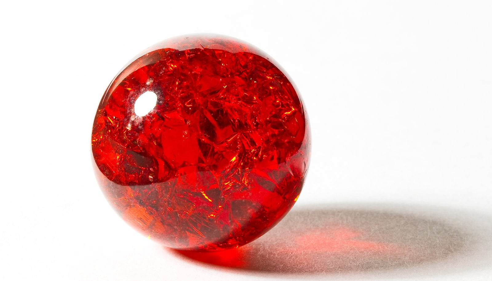

# 火星深处藏着一块异常"热斑"，比周围高出400摄氏度

> 借助一项名为"潮汐层析成像"的技术，科学家发现火星南半球下方的地幔中存在巨大热异常，温度比火星其他区域高出200到400摄氏度。

一块深埋在火星地幔中的热斑，正在改写这颗红色星球的热演化史。

## 用卫星"看穿"行星内部

环绕月球和火星的卫星，已经为科学家提供了关于这两个世界表面的大量信息：它们在月球上找到了水的痕迹，在火星上窥见了可能宜居的表面环境。

但尽管成果斐然，用这些工具去理解地表之下正在发生什么，一直是更难的课题。而布朗大学研究人员开发的一项名为"潮汐层析成像"（tidal tomography）的技术，让科学家能够利用现有卫星，从行星深处提取关键信息。

在发表于《Nature》的一项研究中，由亚利桑那大学的Alexander Byrne领衔的团队用这项技术表明，火星南半球下方的地幔存在一处巨大的热异常。

## 一块热了400度的地幔

研究显示，这块热斑比火星其他区域高出200到400摄氏度。这一发现，为理解这颗红色星球如何随时间演化提供了新线索。

参与该研究的两名布朗大学研究人员，在潮汐层析成像的开发与应用中扮演了关键角色。布朗大学地球、环境与行星科学系副教授Harriet Lau此前曾用该技术揭示地球内部的新信息。她与布朗大学博士后研究员Nick Wagner合作，把这套方法改造用于火星，并希望它很快也能揭示更多关于月球的细节。
