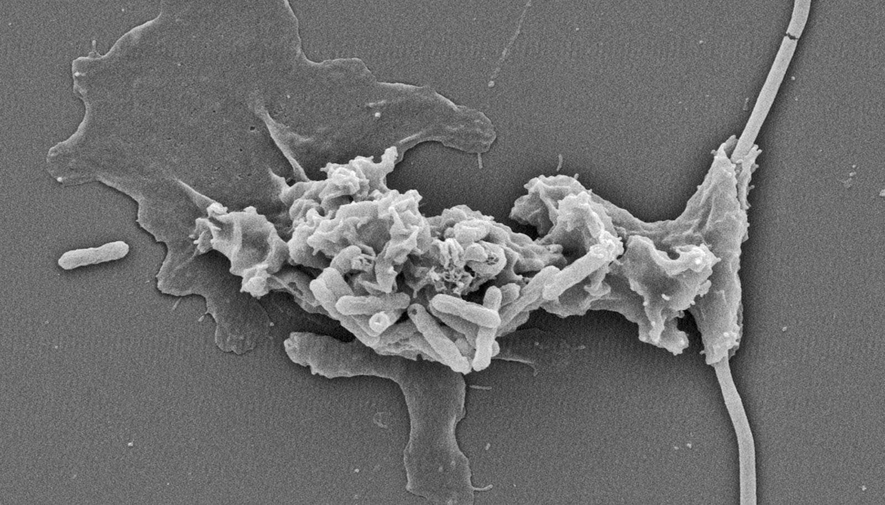

# 破纪录的"火变形虫"，在145°F的高温里照样活得自在

> 生物学家在加州拉森火山国家公园发现了一种能在63°C（145°F）下持续分裂的"火变形虫"，一举打破了"复杂细胞无法在60°C以上存活"的教科书认知，也把已知的真核生命耐热上限又往上推了一格。

在加州拉森火山国家公园发现的 Incendiamoeba cascadensis 能在63°C下持续分裂，刷新了真核生命的耐热纪录。

## 一条被推翻的老规矩

几十年来，科学家们一直依赖一条简单的经验法则：温度一旦超过60°C（140°F），复杂细胞就该活不下去。而这次新发现的嗜热变形虫，正在挑战这个假设。

微生物学家长期研究极端环境，目的是理解"生命如何在自身极限的边缘存活"，雪城大学（Syracuse University）助理教授、近期《细胞》（Cell）论文的共同作者 Angela Oliverio 说。她指出，这个根本问题"有助于我们思考生命可能如何存在于宇宙其他地方"。

以往这类研究大多集中在细菌和古菌身上——它们没有细胞核，也没有真核细胞那套复杂的内部结构。至于真核生命如何应对极端高温，人类所知甚少。

## 用烧烤夹采样的意外收获

正是这个问题，把 Oliverio 和她实验室的博士生 Beryl Rappaport 带到了加州拉森火山国家公园。她们与奇科州立大学的 Gordon Wolfe、波特兰州立大学的 Ken Stedman 合作，在那里采集地热区样本。拉森分布着大量化学性质各异的高温地热泉，是探究生命极限的理想天然实验室。但团队并没有在公园那些著名的酸性池中找到这种破纪录的变形虫，而是在一条看起来毫不起眼的小支流里采到了它——这也凸显出，地球的极端生境里或许还藏着多少未被发现的生命。

在拉森的野外工作绝非散步。那里的地热区布满滚烫的热泉和松软不稳的地面。"因为我们采样的是温度极高的环境，必须采取大量安全防护措施。"论文第一作者 Rappaport 说。

团队依靠特别加长的采样工具，与沸水和脆弱地形保持安全距离。而在最终发现火变形虫的那条狭窄支流里，他们甚至放弃了标准设备，改用烧烤夹在溪流的逼仄处取样。

## 一路加温，纪录被刷新

样本带回雪城大学后，团队开始在培养箱里逐步升温。从57°C升到60°C，变形虫还在继续生长；到了63°C（145°F），它们仍在分裂，创下真核生命的新纪录。到64°C时，它们依然能运动；到70°C（158°F），它们形成包囊——一种能在极端条件下存活、等温度回落后再复苏的休眠结构。

此前生物学家推测，真核细胞的膜在约60°C（140°F）以上就无法保持稳定。而这一新物种，被命名为 Incendiamoeba cascadensis，拉丁语意为"来自喀斯喀特山脉的火变形虫"，名字既点出了它的耐热本领，也记录了它的发现地。

## 不只是外星生命的问题

"我们以为是对的东西，其实并不成立。"Oliverio 说，新数据拓展了"生物学上可能"的边界。她补充说，很可能还有大量耐热真核生物尚未被发现。

理解生命的温度极限，能帮助科学家缩小地外生命的搜寻范围——温度、pH 值和压力，都为生物能存活的场所设下了物理约束。"通过扩展复杂生命已知的温度范围，这一发现为真核生物可能存在的地点打开了新的可能。"Oliverio 说，其中既包括地球上的极端环境，也可能包括其他行星。

影响还不止于天体生物学。这种生物或能为生物技术提供新洞见：那些帮助细胞膜和蛋白质撑过高温的适应机制，未来或许能用于开发热稳定酶、更坚韧的生物材料，以及高温生物工艺。

研究也不止于 Incendiamoeba。用同样的培养技术，Oliverio 实验室的成员正在发现更多极端微生物，甚至就在校园里。本科生们正在研究这类嗜热生物如何定殖人造环境，其中一个案例研究就盯上了纽约州立大学环境科学与林业学院校园里的一根蒸汽管道——从高温土壤和接触蒸汽的表面采样、培养，学生们逐渐意识到：极端微生物并不只存在于热泉或深海热液口，它们也能在意想不到的人造环境里活得很好。

对 Rappaport 来说，乐趣的一部分来自在显微镜下看到某种全新的东西。她记得变形虫第一次在培养瓶里爬动的情景。"看到也许从未有人见过的生物，那种感觉太不可思议了。"她说。

而在 Oliverio 看来，这一发现提醒人们：生命的边界，并不总在科学家以为的地方。"我们应该扩大搜寻的范围。"她说。

本研究得到美国国家科学基金会、NASA、美国物理学会、美国国立卫生研究院、霍华德·休斯医学研究所、Water and Life Interface Institute、阿尔弗雷德·P·斯隆基金会、雪城大学、欧盟委员会、欧洲分子生物学实验室、瑞士国家科学基金会、戈登与贝蒂·摩尔基金会，以及美国能源部科学办公室的支持。
