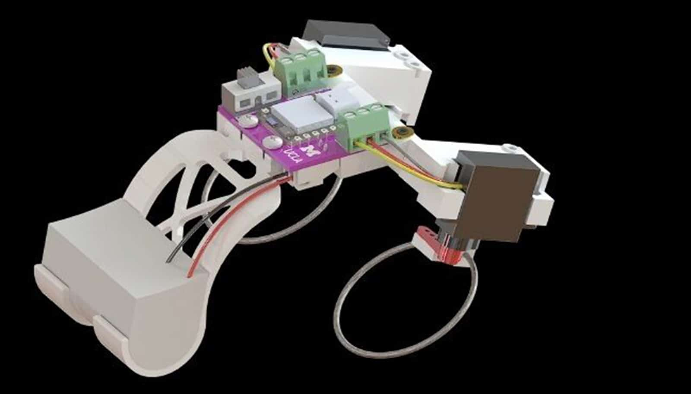

# 这只掌心大的机器人靠"啪"地一弹，像青蛙一样跳和游泳

> 研究者发现，被弯曲又扭转的弹性杆在特定组合下会瞬间"啪"地弹向另一种形状；团队据此优化出螺旋结构，造出每秒能跑约三个身位、能上下台阶、装上桨叶还能游泳的微型机器人。

靠尾部一对会"啪"地弹动的弹性杆推进，这只掌心大小的机器人能跳、能爬台阶、还能游泳。

## 一根杆为什么会"啪"地弹出去

弯曲的弹性杆在被扭转时会产生一种"啪"的弹动，让小型机器人得以跳跃或游泳——研究人员已经用实验证明了这一点。研究团队表示，这为功率有限、尤其是微型机器人提供了一种很有前景的驱动机制。

这项研究发表在《Science Advances》上，由加州大学洛杉矶分校（UCLA）机械与航空航天工程副教授 Khalid Jawed，和密歇根大学机器人学助理教授 Xiaonan（Sean）Huang 共同领导。

## 让"结构的力学"替电机干活

Huang 说："更大的机会在于，让机器人自身的力学结构去承担一部分原本需要更大电机或更复杂控制来完成的工作。""通过设计弹性结构在何时储存能量、何时迅速释放，我们可以让小机器人获得强大、可重复的运动，而不必让电机持续高负载输出。未来，这一原理可能适用于必须在杂乱地形中穿行、越过障碍、快速调整姿态，或需要在陆地和水面之间切换的机器人。"

当一根柔性杆被弯曲、两端同时被旋转时，它最终会到达一个临界点，通过改变形状来释放积聚的张力——但这种变化并不总是一样的。在某些弯曲与扭转的组合下，杆是逐渐变形；在另一些组合下，它会迅速从一种形状"啪"地弹到另一种，从而可能提供强劲的推力。

## 从模型到会跳的真机器人

通过计算机建模和实验，团队优化出一种螺旋形状——像盘绕弹簧的一段——它在最大化能量爆发的同时，还能快速复位以迎接下一次弹动。

Jawed 说："决定一根杆是骤然弹开还是缓慢变形，靠的是它的形状而非尺寸，所以同一套设计规则可以适用于很宽的尺度范围。"他的实验室负责模拟与机械臂实验。"这为几毫米宽的机器人打开了一条有希望的路，把微小的电机运动变成强劲的动作爆发。"

优化完推进机制后，团队设计并制造了真机器人，用这些会弹的杆来跳跃。杆连着旋转电机，被弯曲的杆不断扭转，直到产生弹动；随后电机反向解开扭转，再重新扭曲杆身。

密歇根大学博士后 Dezhong Tong 说："一旦我们能预测一根杆何时会弹，就能利用这个突然的能量释放，把简单的电机运动变成有力的推击，让机器人向前跳出去。"他是这项研究的共同第一作者，另一位是密歇根大学机器人学博士生 Jiaqi Wang。Tong 在 UCLA 的 Jawed 组读研究生时就开始做这个项目。

## 木地板、玻璃、沙子、草地都能走

这个像青蛙的原型机在尾部装了一对会弹的杆，在多种测试表面上跳跃成功——从木材、玻璃这样的硬质材料，到皮革这样柔软光滑的材料。在户外，这个掌心大小的机器人还能对付沙地和草地，能上下台阶，装上桨叶甚至能游泳。

让两根弹杆以不同速率运作，机器人就能转向；团队用遥控器让它在布满岩石障碍的小沙盘里穿行。他们还用光传感器实现了一种简单的自动导航：机器人会朝光源靠近。

这个重约0.25磅的小原型机，每秒能移动大约三个身位——和一只刚孵化、正往海里爬的赤蠵龟差不多。

研究其他作者来自密歇根大学、纽约的 Vassar College，以及英国的 Newcastle University。研究由美国国家科学基金会资助。
