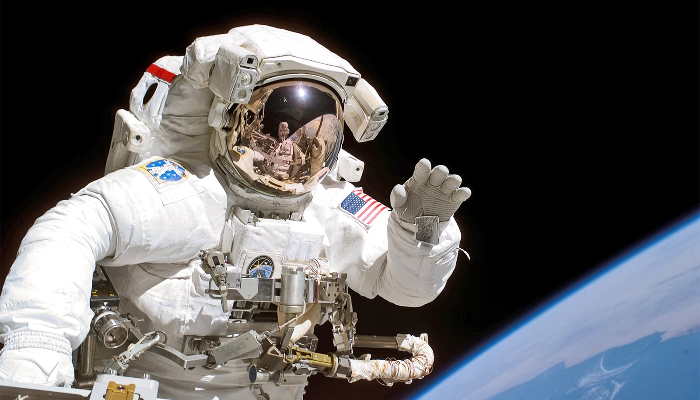

# 模拟零重力下的人类基因组：重力几乎"无能为力"

> 纽约大学团队在实验室里造出模拟零重力，让活细胞在其中待上24小时，结果发现人类基因组的组织与动态几乎没有受到影响——这既回答了重力在地球生命中的角色，也指向太空旅行对人体的潜在影响。

研究人员用随机定位仪模拟零重力，观察活细胞中的基因组在"失重"24小时后的变化。

## 一个悬而未决的问题：重力在基因组里扮演什么角色

1990年启动的人类基因组计划，在数十年遗传学突破的铺垫下，最终给出了人类基因组的完整序列。但基因组如何被"打包"、组织，背后的物理规则至今仍是活跃的研究领域，许多问题没有答案。其中一个被长期忽略的因素，是几乎无处不在、支撑着地球生命一切的重力。

纽约大学物理系副教授 Alexandra Zidovska 领导的团队，把这个问题带上了《Science Advances》。他们用的方法颇为巧妙：在实验里制造一个零重力、也就是微重力环境，从而把重力从变量里"拿掉"。

这个方法一箭双雕。一方面，排除重力这个因素，就能单独观察它对基因组的影响；另一方面，微重力环境本身也模拟了外太空——在没有重力的地方，人类基因组会是什么样子。

## 把两米长的DNA塞进十微米的细胞核

人类基因组的组织方式既复杂又紧凑，是一种层层嵌套的层级结构。它本质上是写在线性序列里的一维信息，却被折叠成三维形态塞进细胞核——两米长的DNA分子，要被装进直径仅约10微米、差不多一根蚕丝粗细的空间里。

结构直接决定功能。一旦偏离正常的组织方式，就可能引发癌症等疾病和发育障碍。但支配这种组织的物理原理，人们了解得仍不够。

"我们不知道重力的存在是否、以及如何影响这种组织，也不知道失去重力会不会造成基因组异常。"Zidovska 说。

## 用一台"随机定位仪"在地球上失重

为了探究这个问题，NYU 团队专门设计并搭建了一台定制实验设备——随机定位仪，可以在活细胞中直接对基因组成像。他们还准备了无气泡的活细胞培养皿，因为气泡会干扰测量。随后，仪器让培养皿沿两条独立转轴按三维路径旋转，形成模拟微重力，也就是地面上的"失重"状态，原理类似宇航员训练时用的大型设备。

团队还开发了新的三维旋转算法，它不仅模拟了微重力，还把三维旋转通常会产生、而真实零重力环境下并不存在的液流降到最低。此外他们另写算法，专门研究液流对细胞和基因组的影响。这些技术改进共同减少了液流和细胞聚集体的形成——在以往的研究里，正是这两者常常掩盖了模拟微重力的真实效果。

为了厘清微重力和液流各自的作用，研究人员把三组细胞放在一起比较：处于模拟微重力且液流被抑制的细胞、处于强液流中的细胞，以及完全没有暴露的细胞。

## 24小时后：基因组出奇地"稳"

细胞在模拟微重力或液流中暴露24小时后，科学家用精密成像技术拍下它们的状态，并录制连续图像流，对细胞做细致的物理分析：细胞形态与体积、细胞核形态与体积、核膜、基因组，以及核仁——细胞核中最大的液态凝聚体。更具体地说，他们关注基因组组织的改变、动态变化，以及模拟微重力是否造成了DNA损伤。

结果指向同一个结论：基因组比预想的要"扛得住"。

"我们的数据显示，基因组及其组织和动态异常稳健，24小时后似乎没有受到重力存在与否的影响。"Zidovska 说。

她同时留了一句余地："同样，这些结果提示，在相当的时间尺度内，人类基因组的物理组织在外太空可能只发生极小变化。但如果暴露时间更长，或者太空中的DNA损伤累积，情况可能会改变。"

这项研究部分由美国国家科学基金会和美国国立卫生研究院资助。研究内容的解释权仅属于作者，不代表美国国立卫生研究院的官方立场。
