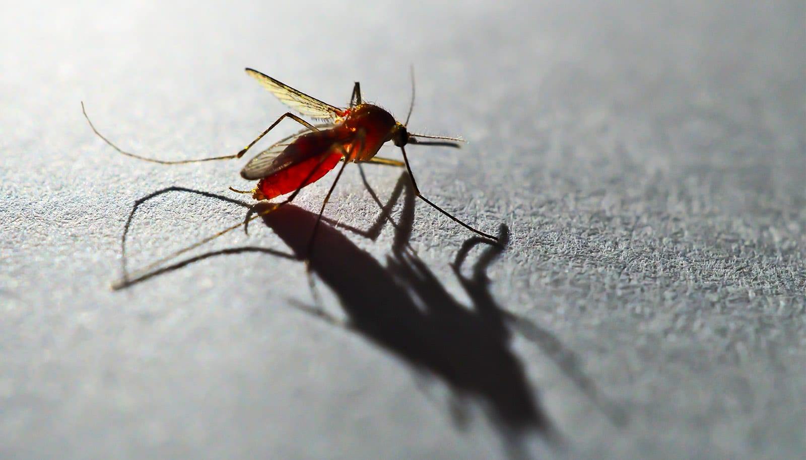

# 间日疟原虫的「阿喀琉斯之踵」，或为新疫苗打开一条路

> 研究人员在间日疟原虫（P. vivax）表面抗原上找到了一处 40 多年未被发现的新弱点，抗体瞄准这里就能在寄生虫「潜伏」肝脏之前把它拦下——这或许能掐断约四分之三的传播来源。

间日疟原虫会在肝脏里潜伏多年后反复复发，这处新发现的弱点可能正是破解之道。

## 40 多年来的第一次

研究人员在间日疟原虫（Plasmodium vivax，简称 P. vivax）身上发现了一处此前未知的脆弱点。这种疟疾寄生虫在中南美洲和东南亚感染了数百万人。

该发现确定了寄生虫身上一个特定位置——抗体可以瞄准它，阻断 P. vivax 侵入肝细胞，从而有望在寄生虫建立起「休眠形态」之前将其拦截。正是这种休眠形态，让疟疾能在数月甚至数年之后卷土重来。

这项发表在《Immunity》期刊上的成果，为研发针对 P. vivax 的疫苗提供了一个新靶点。P. vivax 是撒哈拉以南非洲之外分布最广的疟疾寄生虫。

「40 多年来，没有人发现过一种可靶向 vivax 主要表面抗原 CSP 的新方法。」南佛罗里达大学公共卫生学院全球、环境与基因组健康科学系教授 Noah Sather 说，「这确实是一个改变游戏规则、颠覆范式的发现。」

## 找到了「盔甲上的一道缝」

Sather 与 John Adams 在寄生虫的主要表面蛋白上，确定了一个此前未被表征的「表位」（epitope）——即寄生虫抗原上可被抗体识别并攻击的一个特定区域。这种主要表面蛋白被称为「环子孢子蛋白」（circumsporozoite protein，CSP）。他们的研究显示，靶向这一新发现位点的抗体，能够阻断 P. vivax 感染肝脏。

这对 P. vivax 尤为重要，因为它能在肝脏内建立休眠形态，在初次感染很久之后依然存留，随后重新激活，引发一轮又一轮疟疾。新研究证明，靶向这处新弱点部位的抗体，可以在这些休眠形态形成之前阻断感染，从而可能同时预防发病与传播。

「实际上，大约四分之三的 vivax 传播来自复发感染，而不是第一次被蚊子叮咬、由此获得的那次感染。」Sather 解释说，「我们的疫苗和抗体能够阻止休眠形态的形成，所以这有可能真正击中传播和发病的主要源头。」

在此之前，研究人员对 CSP 表面抗原上可被抗体靶向、从而预防 P. vivax 感染的保护性位点所知有限。而这项由南佛罗里达大学主导的研究，确定了一个具有抑制作用的疫苗表位，它能诱导出阻断寄生虫侵入宿主的抗体，为疫苗设计提供了新靶点。

Sather 把它比作找到了 P. vivax 的阿喀琉斯之踵。「我们发现了盔甲上一种新的缺口，可以这么说，此前没人知道它的存在。」他说，「我们发现可以借此阻止这个虫子感染。这是一种完全未知、也从未被定义过的新弱点。」

## 两支团队在会议室撞上了

这项发现的过程颇为不同寻常：两支研究团队最初各自独立工作，从不同的科学方向逼近 P. vivax，却抵达了寄生虫身上同一个脆弱区域，随后才联手。

一年前，Adams 和他在南佛罗里达大学的研究团队通过研究寄生虫与人类免疫反应确定了这个靶点。与此同时，Sather 还在华盛顿大学担任教授、并在西雅图儿童研究所担任首席研究员，正在分子层面研究同一区域，将其视为疟疾疫苗的可能靶点。

两人都不知道对方的工作。直到 Sather 在考虑加入南佛罗里达大学公共卫生学院疟疾研究项目时造访该校，情况才发生变化。

「我们俩都不知道对方在这方面的进展。」Sather 回忆道，「我们当时坐在同一个会议室里，Adams 博士和他的小组开始谈起这件事。我立刻就明白他们在说什么。我当时想，『天哪，他们说的是这个表位！』」

来自人类研究和疫苗开发实验两方面的证据难得地汇合在一起，让他们相信已经确定了一个重要的新靶点。

「Adams 博士是寄生虫学家，我是疫苗免疫学家——我们是从完全相反的方向看这个问题。」Sather 说，「我是在一个原子一个原子、一个分子一个分子地拆解它，而 Adams 博士则采取大规模、自然免疫关联的方法。合在一起，我们的数据像拼图一样契合，拼出了一幅非常复杂的图景。」

## 别忽视撒哈拉以南非洲之外的疟疾

尽管这项发现是重大进展，Sather 和 Adams 仍指出，消除疟疾还有很长的路要走。另一种疟疾寄生虫——恶性疟原虫（Plasmodium falciparum）——造成了撒哈拉以南非洲的大多数病例，若不在 24 小时内治疗可导致重症或死亡，它获得了绝大多数研究关注。而 P. vivax 影响着世界上很大一部分地区，历史上却受到的关注较少。

「在我们开始研究时，关于如何有效靶向这一主要表面抗原的工作做得非常少。」Sather 说，「然而世界上有如此广大的地区深受其害。」

控制 P. vivax 最大的挑战之一，是它躲藏在肝脏里的能力。与 P. falciparum 不同，P. vivax 可以在初次感染很久之后仍在肝脏中休眠，并在数月乃至数年后重新激活。

「大约从 6 个月到 30 年之后，肝脏里都可能随机发生重新激活。」Sather 说，「你会发起高烧、出现疟疾并发症，而最重要的是，你可以通过蚊虫叮咬把它传播出去。这是一种不同寻常、难以理解、也难以对抗的传播模式。」

## 可行性已经确立

虽然基于这项发现的疫苗仍需数年时间，但 Sather 表示，前进的道路如今清晰得多，最终可能挽救生命，并为一种研究不足的疟疾提供一件有力的新工具。

如果成功，围绕这一新发现的靶点构建的疫苗，或能成为预防 P. vivax 疟疾的新手段——尤其是通过在这些让疟疾极难控制的休眠肝脏形态形成之前拦下寄生虫。

「我们距离把它推进到人体还差几步开发，但可行性已经确立。」Sather 说，「我们的下一步，是把这项发现转化为有效的疫苗配方。」
