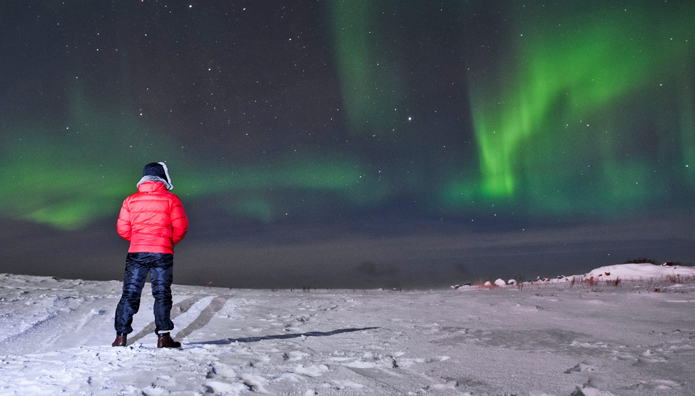

# 宇宙射线如何闯入地球大气？科学家用大型强子对撞机首次复现

> 一个国际物理团队首次在大型强子对撞机中引入氧束流，与质子束相撞，模拟高能宇宙射线轰击地球大气的过程；结果发表在《物理评论快报》，并显示此前的模型「非常不准确」。

科学家用 CERN 的大型强子对撞机复现高能宇宙射线与地球大气的碰撞。

## 比太阳粒子强百万倍的家伙

当来自太阳的粒子闯入地球大气，会引发绚烂的北极光，为北半球的数百万人带来一场偶发的宇宙表演。但这些粒子——也就是低能宇宙射线——与地球气体碰撞、进而形成极光的具体机制，人们了解得并不多。

更令人困惑的是高能宇宙射线的碰撞，它们携带的能量超过太阳粒子的一百万倍，来自爆炸的恒星，即超新星。科学家通常依赖计算机模拟来解析它们与地球大气的碰撞，但这些方法得出的结果五花八门，有时甚至相互矛盾。

一个国际物理学家团队的新研究采取了一种前所未有的办法，为这些星际奇观提供了更清晰的理解。他们利用欧洲核子研究中心（CERN）的大型强子对撞机（LHC），复现了高能宇宙射线闯入地球大气、与地球气体碰撞的过程。成果发表在《物理评论快报》上，有助于破解宇宙星际粒子的起源。

## 首次引入氧束流

「我们现在对来自比太阳更奇异天体的粒子如何与我们的大气相互作用，有了更好的理解。」领导该研究的纽约大学物理学助理教授 Jesse Liu 说，「通过推进我们对地球大气中高能宇宙碰撞的认识，我们向揭开宇宙诸多谜团又迈出了一步。」

「发表的结果确实非同寻常，因为这些数据独一无二，而且在测量中我们得以证明，我们此前针对这类相互作用的模型其实非常不准确。」论文作者之一、柏林洪堡大学物理学家 Cigdem Issever 补充说。

认识到计算机模拟的局限后，Liu、Issever 及其同事——其中包括汉堡 DESY 研究中心的科学家——转向位于日内瓦郊外的 LHC，这台世界上最强大的粒子物理机器，设计出一项创新实验，模拟高能宇宙射线如何与地球大气碰撞。

研究聚焦氧在地球大气中的基础性作用，科学家首次在 LHC 中引入氧束流，让它与 LHC 产生的质子束相撞——后者复现的正是来自超新星的宇宙射线。这一结果构成了世界上首次在受控实验条件下复现「宇宙风暴」的测量。

## 一秒四千万次碰撞，一亿像素相机

研究者用一台一亿像素的相机，对碰撞结果拍摄了数百万张特写，记录下每秒多达 4000 万次的质子碰撞余波。

作为 CERN 的 ATLAS 合作项目的一部分——该项目致力于探索物质的基本性质以及塑造宇宙的基本力——这套精密装置测量了质子—氧碰撞中产生的粒子数量、能量和角度，为这些宇宙风暴的诞生提供了精确画像。

「这些新结果显著提升了我们对这些亚原子相互作用的认识，将帮助我们进一步探索从天而降的宇宙粒子的本质。」Liu 总结道。
