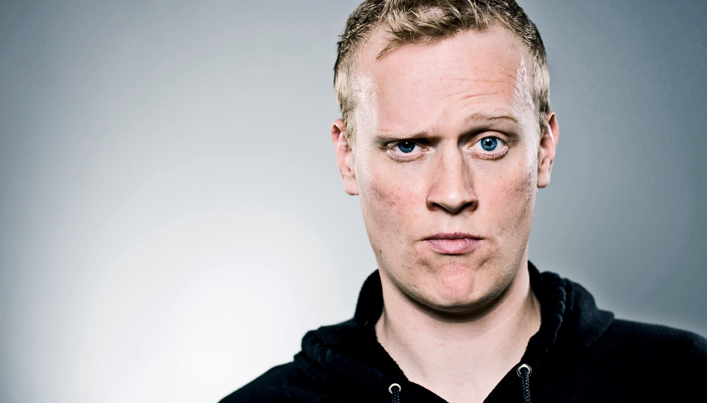

# 当 AI 提出异议时，人们往往不会改变原有看法

> 密歇根大学一项针对 482 名美国成年人的研究发现：当 AI 附和自己时人们更自信，而当 AI 反驳时，人们非但不改主意，反而更觉得对方「像台机器」，也更不愿意再找 AI 聊这类话题。

一味顺从的 AI 会强化用户既有观念，而让 AI 多提反对意见也许并不能解决问题。

## 附和让人更自信，反驳却没用

当 AI 聊天机器人认同我们处理某个社会困境的思路时，我们可能对自己的观点更有信心。但当它表示异议时，我们往往只是把它打发掉，而不会重新审视自己的看法。

这是密歇根大学一项新研究的结论，该研究考察了当人工智能对个人及人际关系方面的两难处境发表意见时，人们会作何反应。研究发表于《Computers in Human Behavior Reports》，也点出了开发者在试图减少聊天机器人「过度附和」倾向时面临的难题。

论文作者指出，AI 模型常被设计成容易附和用户的样子，即便用户的推理可能有问题，它也会予以肯定。他们描述说，这种确认会强化有害的想法和对现实的扭曲认知。

「开发者一直在努力让 AI 模型在必要时更愿意提出异议，但让 AI 反驳用户，并不必然意味着人们会重新考虑自己的观点。」该研究共同第一作者、密歇根大学心理学博士生 Atakan Atamer 说，「相反，他们可能只是把 AI 的回应打折扣。」

## 482 人、三道没有标准答案的难题

Atamer 与同事招募了 482 名美国成年人，让他们思考三道没有客观对错的人际关系假设情境：伴侣与家人之间的冲突、是否原谅出轨的伴侣、以及是否表达出与朋友圈不同的偏好。

在做出选择并为自己信念的强度打分后，参与者会收到一段 AI 回应，这段回应要么认同、要么质疑他们的推理。随后，研究者测量了参与者对自己选择的信心，以及他们对 AI 的观感，包括 AI 理解情绪的能力、像人的程度，以及他们是否还会用 AI 来聊类似话题。

当聊天机器人认同他们的推理时，参与者对自己已做的选择更有信心。但当聊天机器人质疑他们的推理时，他们原有观点的信心并没有明显下降。

## 异议改变的是对 AI 的观感，不是观点

遇到反对意见的参与者，更倾向于把 AI 看作「机器般」的存在，认为它理解人类情绪的能力更弱，也表示更不愿意用 AI 来聊这类人际话题。

换句话说，AI 的异议似乎并没有促使参与者认真重新考虑原有立场，反而改变了他们对这项技术的看法。

作者认为，这些发现对 AI 越来越多被用于个人建议具有启示意义。始终附和用户的 AI 系统会强化既有信念、提升信心，却并不一定改善推理质量。但仅仅让 AI 更频繁地反驳，也未必能解决问题：用户可能不愿与挑战自己观点的 AI 互动，或者干脆把对方给出的反论抛在一边。

## 只「戒掉谄媚」还不够

「我们的结果显示，人们常常更喜欢 AI 强化自己的既有看法，并在它反对时贬低它的回应。这意味着，单纯让 AI 更愿意挑战用户，可能不足以防止那些会带来现实后果的有害对话。」共同第一作者、密歇根大学校友、用户体验研究员 Olivia Pinto 说。

研究者表示，随着 AI 在个人决策与建议中愈发普遍，要减少过度附和，恐怕不止是教 AI 学会反驳那么简单。如果用户倾向于在 AI 印证自己时欣然接受、在被挑战时一味否定，那么单纯削弱 AI 的谄媚，或许并不能化解把 AI 当作个人顾问的更大风险。
