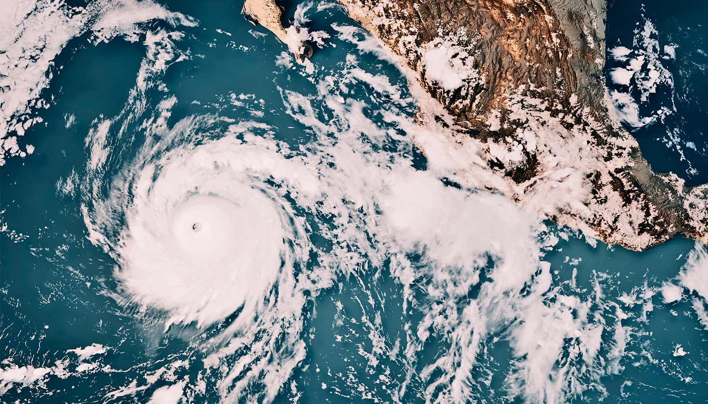

# 研究：近40年的厄尔尼诺强度已超过此前1000年

> 一项发表在《科学》杂志的研究发现，过去40年的厄尔尼诺事件比工业化前强了近40%，而这一强度在公元1850年之前的整整一千年里从未出现过；研究者由此警告，「超级厄尔尼诺」可能变得更加常见。

研究人员通过加拉帕戈斯群岛的珊瑚重建了东太平洋上千年的气候记录。

## 圣巴巴拉外海出现了「多拉多」

一个规模堪称历史级的厄尔尼诺正在热带太平洋成形。8月下旬，加州圣巴巴拉外海的水温升到了70华氏度出头，有钓鱼者报告在海峡群岛附近钓到了鲯鳅（dorado）和黄尾鰤。

新研究的作者们检视了加拉帕戈斯群岛的现代珊瑚与古代珊瑚，发现过去40年间的厄尔尼诺事件，强于1850年前后——也就是人类开始用温室气体影响气候之前——的那一千年里的任何时期。该研究发表于《科学》杂志。

「多亏这些新的珊瑚重建记录，我们能比以往任何时候都更深入东太平洋的过去。」论文合著者、加州大学圣巴巴拉分校布伦环境科学与管理学院助理教授 Samantha Stevenson 说，「当我们这么做时，我们看到厄尔尼诺一直在变强，而这种变化在过去几百年里真正加速了。」

「我们证明厄尔尼诺的强度与全球气温的升高同步变化。」论文第一作者、密歇根大学地球与环境科学系教授兼系主任 Julia Cole 补充道，「我们的发现说明，过去40年这些大型厄尔尼诺，放在过去一千年的尺度上看并不正常。」

## 厄尔尼诺是怎么发生的

厄尔尼诺是一种自然现象，每隔几年就会让热带太平洋比往常更暖。在正常情况下，信风沿赤道自东向西吹，把南美洲的暖水推向澳大利亚。但当信风减弱，这些暖水便向东扩散、回到南美一侧，由此触发厄尔尼诺。

大气环流随之响应：强降雨从印度尼西亚转移到太平洋中部，让西太平洋变得干燥，又进一步削弱信风，把厄尔尼诺状态锁定下来，可持续一到两年。这些温度和降水的波动虽源于热带太平洋，却会影响全球天气。

在美国西部，这套变化会把急流推向更南的位置，使大气河风暴从太平洋西北改道加州。「对我们南加州来说，一次大厄尔尼诺往往意味着湿润的冬天。」Stevenson 说。翌年情况常常反转，变成「拉尼娜」。世界各地的类似变化会引发干旱与洪灾，进而带来疾病、作物歉收、山火等影响人们健康与福祉的危机。

「问题不是当前的厄尔尼诺会不会发生，而是它会有多糟、影响会多大？」Cole 说，「这次事件叠加在全球变暖之上，很可能为本就因温室气体而上升的气温再添一把火。」一些预报认为，气温可能达到比工业化前高1.7到1.8摄氏度（3.1到3.2华氏度），Cole 说，这「比现有纪录高得相当多」。

## 珊瑚里藏着的温度记录

为了考察历史厄尔尼诺模式，作者们从加拉帕戈斯群岛采集了13份珊瑚岩芯，既有活体群落，也有古代珊瑚巨石。珊瑚每年通过分泌碳酸钙层生长一到两厘米，这些层的化学构成记录了珊瑚生长时海水的温度。

由于厄尔尼诺极端事件每隔几年出现一次，研究者聚焦于跨度至少20年的样本，以毫米为单位逐层测量珊瑚骨骼化学构成的两个方面：一是锶与钙的比例，它取决于海水温度；二是氧元素不同同位素（原子量）的比例，同样是当地温度的替代指标。

团队由此得到一部加拉帕戈斯温度变化史——Cole 解释说，那里正是厄尔尼诺影响最大的地方。他们发现强厄尔尼诺集中出现在最近40到50年，而在此之前，厄尔尼诺呈现出「相当一致的较低强度模式」。

「我们不断加入新记录，以为『好吧，这该变得更复杂了』，但事实并没有。」Cole 说，「这个故事清晰得不能再清晰。」

研究者随后检验了其他自然过程是否可能在过去千年里造成类似的厄尔尼诺增强。为此，他们使用了纳入火山喷发史和太阳活动变化的climate模型。模型没有给出理由相信，如此大的厄尔尼诺变化是由其他自然过程造成的。

## 模型为何没抓住趋势

「让我担心的是，没有一个气候模型捕捉到我们在珊瑚记录里观察到的增强。」Stevenson 说，「这很可能意味着，模型漏掉了厄尔尼诺对气候变化响应方式的某些东西，我们需要弄清原因。」她的团队正在研究不同气候模型之间的细微差异，以进一步改进预测。

这些发现凸显出认真应对全球变暖的紧迫性。「如果这一趋势延续到未来，像如今正在发展的这种『超级厄尔尼诺』，可能会变得常见得多——连同它带来的一切影响。」Stevenson 说。

「干旱、洪水、山火和粮食不安全。」Cole 补充道，「水文循环的变化还会导致基础设施受损：冲毁房屋、公路或铁路的洪水；或健康影响，如霍乱之类疾病。」

「我们相信全球变暖正在给厄尔尼诺加力。」Cole 继续说，「如果真是这样，那么我们预计会出现更强的气候极端事件，放大生态、基础设施和人类的损失。没有哪个国家拥有足以完全抵御这些影响的资源。这又给了我们一个理由，去摆脱化石燃料这个问题的根源。」

该研究的合著者来自密歇根大学、亚利桑那大学、爱丁堡大学、科罗拉多学院、伊利诺伊大学、穆迪风险管理服务公司以及明尼苏达大学。研究获得美国国家科学基金会和英国自然环境研究理事会的支持，加拉帕戈斯国家公园和查尔斯·达尔文研究站也提供了协助。
